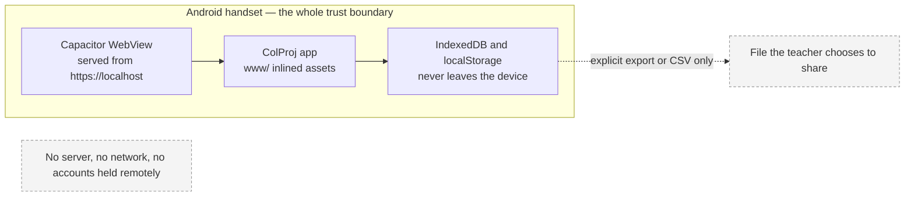

# Architecture Diagram

ColProj is a Capacitor Android app that ships a folder of plain web files. There
is no bundler, no framework, no server and no network path at run time. The
diagram shows the runtime layers, the module boundaries, and the off-device build
and test tooling.

```mermaid
flowchart TB
  %% ---------------- Entry ----------------
  subgraph ENTRY["Entry point"]
    BOOT["www/index.html<br/>boot sequence: inline ort config,<br/>Settings.load, seedIfEmpty, go('login'),<br/>warm the engine in the background"]
  end

  %% ---------------- Presentation ----------------
  subgraph UI["Presentation layer — no framework, plain script tags in load order"]
    SHELL["shell(), esc(), toast(), sheet(), confirmSheet()<br/>www/js/ui.js"]
    ROUTER["VIEWS / ACTIONS router<br/>go(), back(), render(), wire()<br/>www/js/ui.js"]
    CAPTURE["Capture and review screens<br/>login, home, capture, review, sessionview<br/>www/js/ui.js"]
    ADMIN["Management screens<br/>classes, klass, student, enrol, timetable,<br/>people, requests, history, uat, audit<br/>www/js/admin.js"]
    STYLE["Design tokens and layout<br/>www/css/app.css"]
    COACH["Coach walkthrough<br/>localStorage progress only"]
  end

  %% ---------------- Core services ----------------
  subgraph CORE["Core services — www/js/core.js"]
    DBW["DB wrapper — get, all, put, putAll,<br/>del, clear, where, wipe"]
    SETTINGS["Settings + DEFAULTS<br/>thresholds, gate, simulator params"]
    DEVICE["Device id in localStorage"]
    CRYPTO["Crypto2 — PBKDF2-SHA256 password,<br/>RFC 6238 TOTP, SHA-256, base32"]
    AUDITH["Audit — hash chain and verify()"]
    SEALF["sealSession() — SHA-256 over the roll"]
    ROLESF["ROLES + Can — rank-based permissions,<br/>scopedKlasses()"]
    CLOCKF["Clock.now / minutes / day<br/>the single server-time seam"]
    GATEF["gateCheck() — timetable, handset,<br/>substitution, override"]
    SEEDF["seedIfEmpty() — depts, klasses, students,<br/>users, timetable"]
    EXPORTF["exportAll() / importAll() / toCSV() / download()"]
  end

  %% ---------------- Recognition ----------------
  subgraph REC["Recognition layer — www/js/engine.js"]
    IFACE["Engine interface<br/>detect(source, opts) and embed(chips, dets)<br/>everything downstream is engine-agnostic"]
    ONNX["OnnxEngine<br/>SCRFD-500M decode plus ArcFace w600k_mbf"]
    SYNTH["SyntheticEngine<br/>deterministic 512-d identities,<br/>Gaussian capture noise, row depth"]
    FIXE["FixtureEngine<br/>replays a recorded frame list"]
    PICK["buildEngine(pref) and modelsPresent()<br/>auto-detect weights, else fall back"]
    GEO["Geometry and maths<br/>similarityTransform, alignChip,<br/>cropBox, nms, cosine, l2normalise"]
    GALLERY["Gallery.forClass(klassId) and match()<br/>per-class templates, score and margin banding"]
    RUNREC["runRecognition(engine, shots, gallery, cfg)<br/>duplicate collapse, toosmall guard"]
  end

  %% ---------------- Platform ----------------
  subgraph PLAT["Platform adapters — browser APIs under Capacitor"]
    ORT["onnxruntime-web 1.19.2 WASM<br/>single-threaded, vendored as<br/>js/ort.wasm.min.js and js/*.wasm"]
    WEBCR["WebCrypto (crypto.subtle)"]
    MEDIA["getUserMedia and file input"]
    CANVAS["Canvas 2D — letterbox, crop,<br/>similarity transform, chips"]
    IDB["IndexedDB"]
    LS["localStorage"]
    BLOB["Blob download for CSV and export"]
  end

  %% ---------------- Stores ----------------
  subgraph STORES["Device-local data"]
    OSCHEMA["IndexedDB 'colproj' v1<br/>users, depts, klasses, students, templates,<br/>timetable, sessions, attendance, requests, audit, kv"]
    LSKV["localStorage<br/>colproj.device, coach flags"]
    WEIGHTF["www/models/<br/>det_500m.onnx 2.5 MB,<br/>w600k_mbf.onnx 13.6 MB"]
  end

  %% ---------------- Ship and test ----------------
  subgraph SHIP["Off-device tooling"]
    BUILDPY["build.py<br/>inlines www/ into dist/colproj.html"]
    CAPCONF["capacitor.config.json + npx cap add android<br/>webDir www, appId in.edu.college.colproj"]
    TESTS["test/logic.test.mjs (node:vm)<br/>test/flow.test.mjs and dist.test.mjs (jsdom,<br/>fake-indexeddb) — 79 tests"]
    CI["GitHub Actions: npm ci and npm test on PRs to main"]
  end

  %% ---------------- Wiring ----------------
  BOOT --> ROUTER
  BOOT --> SETTINGS
  BOOT --> SEEDF
  BOOT --> PICK
  SHELL --> ROUTER
  ROUTER --> CAPTURE
  ROUTER --> ADMIN
  ROUTER --> STYLE
  ROUTER --> COACH
  CAPTURE --> RUNREC
  CAPTURE --> MEDIA
  CAPTURE --> CANVAS
  ADMIN --> RUNREC
  ADMIN --> EXPORTF
  ADMIN --> ROLESF
  CAPTURE --> GATEF
  GATEF --> CLOCKF
  GATEF --> ROLESF
  GATEF --> SETTINGS
  ROLESF --> DBW
  SETTINGS --> DBW
  AUDITH --> DBW
  AUDITH --> CRYPTO
  SEALF --> CRYPTO
  EXPORTF --> DBW
  EXPORTF --> BLOB
  SEEDF --> DBW
  SEEDF --> CRYPTO
  DEVICE --> LS
  DBW --> IDB
  DBW --> OSCHEMA
  LS --> LSKV
  IFACE --> ONNX
  IFACE --> SYNTH
  IFACE --> FIXE
  PICK --> IFACE
  PICK --> WEIGHTF
  ONNX --> ORT
  ONNX --> CANVAS
  GEO --> CANVAS
  GALLERY --> DBW
  RUNREC --> IFACE
  RUNREC --> GALLERY
  RUNREC --> GEO
  CRYPTO --> WEBCR
  AUDITH --> LS
  BUILDPY --> TESTS
  BUILDPY --> CAPCONF
  CAPCONF --> CI
  TESTS --> CI
```

## Layer rules worth keeping

- **Presentation never knows which engine is running.** `ui.js` and `admin.js`
  talk only to `detect()` and `embed()` through `ensureEngine()`; the ONNX,
  simulator and fixture paths are interchangeable.
- **Only `core.js` touches storage.** Every screen goes through the `DB` wrapper
  or a helper built on it (`rosterOf`, `templatesOf`, `enrolledCount`), which is
  why a storage change is a one-file change.
- **`Clock` is the only source of attendance-affecting time.** Swapping the
  device clock for ERP server time is a one-function edit.
- **The engine seam is also the offline seam.** `modelsPresent()` probes for the
  weight files, so the same build runs with the real models on a handset and on
  the simulator in a sandbox where 16 MB of `.onnx` cannot be fetched.
- **`build.py` is packaging, not compilation.** `www/` is the artefact that goes
  into the APK; the single file in `dist/` only exists for sharing, and it runs
  on the simulator because binaries cannot be inlined.

## Runtime boundary

