# Data Flow Diagram — Level 1

Decomposition of process **0 (ColProj)** from the level-0 context diagram.
Everything on this page happens on one Android handset: the whole system is a
single device boundary, with no server, no network call and no remote store.

**Notation.** Rounded shapes are external entities, rectangles are processes,
cylinders are data stores.

```mermaid
flowchart LR
  %% ---------- External entities ----------
  T(["Teacher<br/>takes the roll"])
  M(["HOD / Vice-principal / Principal<br/>administers staff and classes"])
  CAM(["Camera or photo library<br/>on the handset"])
  AUTH(["Authenticator app<br/>RFC 6238 TOTP"])

  %% ---------- Processes ----------
  P1["1.0  Sign in and register handset"]
  P2["2.0  Timetable gate"]
  P3["3.0  Capture class photos"]
  P4["4.0  Detect, align, embed, match"]
  P5["5.0  Review roll and resolve disputes"]
  P6["6.0  Save and seal the roll"]
  P7["7.0  Enrol faces"]
  P8["8.0  Manage roster and classes"]
  P9["9.0  Manage timetable, staff and requests"]
  P10["10.0  History, export and integrity"]

  %% ---------- Data stores ----------
  D1[("D1  users<br/>role, deptId, deviceIds,<br/>pw salt/hash/iters, totpSecret")]
  D2[("D2  depts, klasses")]
  D3[("D3  students<br/>roster, roll, seat, admitType")]
  D4[("D4  templates<br/>512-d descriptors, chip, source, active")]
  D5[("D5  timetable<br/>teacher, klass, day, start, end")]
  D6[("D6  sessions<br/>header, stats, seal")]
  D7[("D7  attendance<br/>state, flagged, conf, source, crop")]
  D8[("D8  requests<br/>substitute / transfer")]
  D9[("D9  audit<br/>hash-chained log")]

  %% ---------- 1.0 Authentication ----------
  T -->|"user id, password, 6-digit code"| P1
  AUTH -->|"current code"| P1
  P1 -->|"read account, verify PBKDF2, TOTP"| D1
  P1 -->|"write deviceIds on first sign-in"| D1
  P1 -->|"signin, signin.fail, mfa.fail, device.register"| D9
  P1 -->|"signed-in user, role, scope"| P2
  P1 -->|"refusal or MFA prompt"| T

  %% ---------- 2.0 Gate ----------
  P2 -->|"own slots and accepted cover"| D5
  P2 -->|"deviceIds, role"| D1
  P2 -->|"gate.override with typed reason"| D9
  P2 -->|"open slot, or reasons nothing is scheduled"| T

  %% ---------- 3.0 Capture ----------
  T -->|"shutter taps, column aim"| P3
  CAM -->|"video frames or gallery images"| P3
  P3 -->|"shot canvases and thumbnails, in memory only"| P4

  %% ---------- 4.0 Recognition ----------
  D3 -->|"class roster"| P4
  D4 -->|"active templates for this class only"| P4
  P4 -->|"faces, bands, per-student best observation"| P5

  %% ---------- 5.0 Review ----------
  T -->|"correct a mark, place an unplaced face"| P5
  M -->|"spot-check a roll"| P5
  P5 -->|"confirmed descriptor as source: dispute"| D4
  P5 -->|"template.add, template retire"| D9
  P5 -->|"present / absent rows, review collapsed to absent + flagged"| P6

  %% ---------- 6.0 Save ----------
  P6 -->|"one row per student"| D7
  P6 -->|"session header plus SHA-256 seal"| D6
  P6 -->|"session.close with seal"| D9
  P6 -->|"the saved roll"| T

  %% ---------- 7.0 Enrolment ----------
  T -->|"3-4 photos per student"| P7
  CAM -->|"photos or gallery images"| P7
  D3 -->|"roster of the class"| P7
  P7 -->|"enrol templates, largest face in frame"| D4
  P7 -->|"template.add"| D9

  %% ---------- 8.0 Roster ----------
  M -->|"new student, roll number, admit type"| P8
  P8 -->|"students, active flag"| D3
  P8 -->|"classes and departments"| D2
  P8 -->|"student.add, template.remove"| D9

  %% ---------- 9.0 Administration ----------
  T -->|"asks for cover"| P9
  M -->|"slots, accounts, roles, 2FA, accept or decline"| P9
  P9 -->|"timetable slots, clash-checked"| D5
  P9 -->|"accounts, roles, deviceIds, TOTP secret"| D1
  P9 -->|"requests and decisions"| D8
  P9 -->|"user.create, timetable.edit, transfer.complete"| D9

  %% ---------- 10.0 History and integrity ----------
  T -->|"view history, download CSV"| P10
  M -->|"integrity check, export or import, thresholds"| P10
  D6 -->|"sessions"| P10
  D7 -->|"attendance rows"| P10
  D9 -->|"audit chain"| P10
  P10 -->|"CSV file, export JSON, rebuild of the seal, verification result"| T
  P10 -->|"rule- or seal-break report"| M
```

## Process detail

| Process | What it does | Implemented in |
|---|---|---|
| 1.0 Sign in and register handset | PBKDF2-SHA256 password check over 210,000 iterations, optional RFC 6238 TOTP, binds the handset id on first sign-in | `ACTIONS.signin`, `askMfa`, `completeSignin`, `Crypto2`, `Device` (`www/js/ui.js`, `www/js/core.js`) |
| 2.0 Timetable gate | Teacher, registered handset and `Clock` must all agree with a live slot, own or via an accepted substitution; override needs a typed reason | `gateCheck`, `Clock`, `ACTIONS.overridegate` (`www/js/core.js`, `www/js/ui.js`) |
| 3.0 Capture class photos | Live camera or gallery import, column-by-column shots, retake and drop, kept as canvases in the live session | `VIEWS.capture`, `ACTIONS.shutter`, `pickfiles`, `addShot` (`www/js/ui.js`) |
| 4.0 Detect, align, embed, match | `detect()` then `embed()` behind the engine interface, align to the 5-point ArcFace template, cosine match per class, score + margin banding | `ensureEngine`, `runRecognition`, `Gallery.match`, `alignChip` (`www/js/engine.js`, `www/js/ui.js`) |
| 5.0 Review roll and resolve disputes | Three outcomes; unplaced faces shown beside the student before anything is written, additions stamped and reversible | `VIEWS.review`, `ACTIONS.rowtap`, `assignFaceTo` (`www/js/ui.js`) |
| 6.0 Save and seal the roll | `review` collapses to `absent` + `flagged`, rows written, SHA-256 seal over the sorted roll | `ACTIONS.savesession`, `sealSession` (`www/js/ui.js`, `www/js/core.js`) |
| 7.0 Enrol faces | Per-student capture, largest detected face used, one template per accepted photo | `VIEWS.enrol`, `ACTIONS.esave` (`www/js/admin.js`) |
| 8.0 Manage roster and classes | Classes in scope, add students, remove a learned face | `VIEWS.classes`, `VIEWS.klass`, `VIEWS.student`, `ACTIONS.addstudent`, `ACTIONS.rmtpl` (`www/js/admin.js`) |
| 9.0 Manage timetable, staff and requests | Clash-checked slots, account creation bounded by rank, 2FA enrolment, cover and transfer requests | `slotSheet`, `ACTIONS.newuser`, `mfaSheet`, `pwSheet`, `ACTIONS.askcover`, `ACTIONS.openreq` (`www/js/admin.js`) |
| 10.0 History, export and integrity | Saved rolls with seal re-derivation, CSV download, full JSON export/import, audit-chain verify, threshold sweep | `VIEWS.history`, `VIEWS.sessionview`, `ACTIONS.csv`, `exportAll`, `importAll`, `Audit.verify`, `VIEWS.uat` (`www/js/admin.js`, `www/js/core.js`) |

## Data stores

All eleven stores live in the IndexedDB database `colproj` (version 1) and are
reached only through the thin `DB` wrapper in `www/js/core.js`.

| Store | Key | Holds |
|---|---|---|
| `users` | `id` | Accounts, roles, `deviceIds[]`, PBKDF2 record, TOTP secret, `mustSetPassword` |
| `depts` | `id` | Department code and name |
| `klasses` | `id` | Class, year, division, department |
| `students` | `id` | Roster: roll, seat, admit type, `active` |
| `templates` | `id` | 512-d face descriptor, chip, `source: enrol / dispute`, `active`, `createdBy` |
| `timetable` | `id` | One scheduled slot per row |
| `sessions` | `id` | Closed session header, stats, threshold, engine, seal |
| `attendance` | `id` | One row per student per session |
| `requests` | `id` | Cover and transfer requests, pending / accepted / declined |
| `audit` | `id` | Hash-chained log, `prevHash` + `hash` per entry |
| `kv` | `k` | `kv/settings` — thresholds and toggles, so a full export captures them |

Two things deliberately sit outside the data stores and are therefore not drawn
as flows: the live capture session (`App.session` in memory — shots, results,
unplaced faces — discarded once the roll is saved) and `localStorage`, which
holds only per-device state that must never sync or be exported:
`colproj.device`, `colproj.coach`, `colproj.coach.on`.
