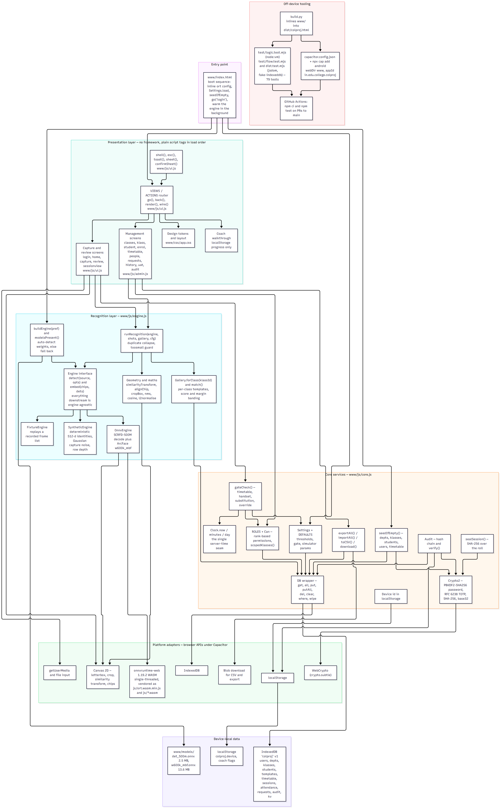
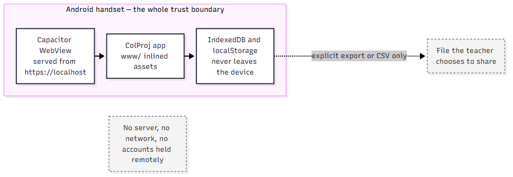

# ColProj — the codebook

**The master document for this codebase.** Read it next to the source and you will
be able to explain any part of ColProj to anyone — an industrial reviewer, a
professor, a classmate, or a ten-year-old.

Written 16 October 2026 against commit `7377d12` on branch
`docs/architecture-diagrams`. Revision notes at the very end.

---

## 0. How to use this document

This codebook is written to be read **side by side with the code**, not instead of
it. Every claim has an *Open:* pointer telling you which file and line to look at.
The discipline is simple:

1. Read a section here.
2. Open the file and line it names.
3. Find the thing described. Confirm the words match the code.
4. Say the "say it out loud" line to an empty room. If it comes out smooth, you
   own that piece.

If a claim in here disagrees with the source, **the source wins** — and this file
has a bug worth fixing.

### Three reading paths

| You have | Read | You will be able to |
|---|---|---|
| 20 minutes | §1, §2, §3, §5, §10 | Give a confident verbal walkthrough of what the app is and the five decisions that matter |
| A half day | §1–§9 in order, with files open | Explain any function, defend any decision, and trace any bug from symptom to line |
| A full deep dive | All of it, then run `npm test` and read `test/*.mjs` | Modify the app safely, extend it, and review someone else's change to it |

### Reading path for the impatient reviewer

§2 (what it is) → §8.5 (the analysis flow) → §9 (decisions) → §10 (invariants) →
§11 (what the tests actually prove) → §13.2 (the dozen questions a reviewer will ask).

### Conventions in this document

- `file.js:123` means line 123 of that file **as of the commit above**. Line
  numbers drift; function names do not. Search for the name first.
- **Plain words** blocks are the explain-it-to-a-kid register.
- **Reviewer words** blocks are the register for a technical examination.
- **Why, not what** blocks are the reasoning; the code already shows you the what.
- **If you change this** blocks describe the consequence of touching the thing.
- **Open:** lines are the paired-reading pointers.

### What this document is not

It does not replace `docs/MANUAL.md` (which is for people *using* the app), and it
does not replace `docs/CONTEXT.md` (which is a compact brief for an AI assistant).
It is the human-readable master: the whole system, file by file, decision by
decision, in the order a newcomer should meet it.

---

## 1. The system at three altitudes

### 1.1 To a ten-year-old

A teacher walks into a classroom with sixty students. Instead of calling out sixty
names and writing ticks, they take three photos of the room on their phone. The
phone looks at the faces in the photos and asks, "is this Ananya? is this Rohan?"
It ticks the ones it is sure about, leaves the ones it is unsure about for the
teacher to decide, and everything else is absent. Then it writes the roll in a
locked notebook that cannot be edited quietly — if anyone changes it later, the
notebook screams.

The phone does all of this by itself. No internet, no computer in the office, no
school server. It is a small, careful, slightly paranoid machine.

### 1.2 To a non-technical adult, one paragraph

ColProj marks classroom attendance from a photograph. A teacher takes overlapping
photos of their class; the app finds every face, compares each one against the face
descriptors of the students enrolled in **that specific class**, and produces a
roll of Present / Needs-checking / Absent. A teacher confirms anything the app is
unsure about, and every confirmation teaches the app that face for next time.
Runs entirely on the Android handset — no server, no network — so a classroom with
no connectivity is a first-class case rather than a failure mode. Attendance
records are sealed with a cryptographic fingerprint and every change is written to
a tamper-evident log, so a roll can be proved unaltered after the fact.

### 1.3 To a technical reviewer, one paragraph

A dependency-free, framework-free, offline progressive web app (2,823 lines of
plain ES2020 across four classic-script files) wrapped in Capacitor as an Android
APK. A pluggable recognition layer exposes exactly two methods —
`detect(source, opts) → [{box, kps, score}]` and `embed(chips, dets) → [Float32Array(512)]`
— implemented three ways behind one interface: real ONNX inference (SCRFD-500M
detector + ArcFace MobileFaceNet recogniser via onnxruntime-web WASM), a
statistically faithful 512-dimensional simulator, and a replay fixture. Downstream
of those two methods, nothing knows which engine is running. Identity is decided
by cosine similarity against an L2-normalised 512-d gallery scoped per class, with
a two-gate decision (accept threshold **and** runner-up margin) producing three
outcomes rather than two; sub-`minFacePx` detections are structurally barred from
auto-matching. Persistence is IndexedDB through a ~10-method wrapper; integrity is
PBKDF2-SHA256(210k) for passwords, RFC 6238 TOTP for second factor, a SHA-256
hash chain over the audit log, and a per-session SHA-256 seal over the stored roll.
Time is read only through a `Clock` seam so a future ERP build can substitute
server time in one place.

### 1.4 The one-sentence version

> A phone that takes a photo of a classroom, recognises the students in it, and
> writes a roll that cannot be quietly falsified.

---

## 2. The physical story (why this shape, not another)

Everything in the code follows from the physical situation. Understand the room
and the design stops looking arbitrary.

**The room.** SPPU engineering classrooms hold roughly 44–69 students in rows.
Lighting is mixed (tube light from above, windows to one side). The back rows sit
5–8 metres from a phone held at the front. A face at the back of a 2560×1440 photo
is 20–40 pixels wide — *below* the width at which face-embedding models separate
people reliably. This single fact dictates the whole capture UX: **column-by-column
shots with overlap**, not one wide photo. It also dictates `minFacePx = 26`: small
faces are reported but never guessed at.

**The teacher's hands.** One hand on the phone, the other on nothing. A flow that
needs two hands or fifteen taps will not be used in a real 50-minute period. Hence
the shutter-first capture screen, the single "Analyse" action, and the roll being
correctable by tapping rows rather than by editing a form.

**The phone's situation.** No server exists. There is no Wi-Fi guarantee, there is
no budget for one, and the college's ERP integration is not yet approved. So: no
network calls at all, everything on-device, model weights shipped inside the app.
This is why the recognition layer is pluggable — the same build must demonstrate
on a laptop with no model files and on a phone with them.

**The stakes of being wrong.** Two failure modes, and they are wildly asymmetric:

- **Wrongly marked absent.** The student notices, objects, the teacher taps one
  row, done. Cost: ten seconds and mild annoyance.
- **Wrongly marked present.** An absentee's record says present. It is invisible,
  it is fraud-shaped, and it is exactly what attendance systems exist to prevent.
  Cost: the system's credibility.

Every threshold decision in the app is tuned for that asymmetry. The app errs
toward "absent / needs checking". It is not a bug that the app leaves work for the
teacher — it is the product.

**The honesty constraint.** The project is a college review subject. Claims have to
be defensible in front of examiners, which is why `docs/CONTEXT.md`,
`docs/SESSION-2026-09-26.md` and the README all record what was *not* done and why
(liveness out of scope, ERP not wired, DPDP consent outstanding). The codebook
inherits that stance: where something is written-but-unverified, it says so.

### 2.1 What the app must never do

These are not preferences; they are the four things that would make the product
worthless:

1. Mark a student present who is not in the room.
2. Let a roll be changed after saving without that change being provable.
3. Help a photograph of a person act as that person (no liveness — stated, not hidden).
4. Depend on the network to open.

---

## 3. Vocabulary (plain words and precise words)

Learn these sixteen terms and the code becomes readable, because the code uses
exactly these words.

| Term | Plain words | Precise meaning | Where |
|---|---|---|---|
| **Roll** | The list of who is in today | One `sessions` row plus one `attendance` row per student in that session | `core.js:244` (seal), `ui.js:735` (save) |
| **Roster** | The students of a class | Active `students` rows with `klassId` matching, sorted by roll number | `core.js:526` |
| **Klass** | A class, e.g. "TE CS — Division A" | `{id, deptId, year, division, name}` — the word is spelled with a *k* to avoid the reserved word `class` | `core.js:8` store map, `core.js:445` seed |
| **Session** | One taking of attendance | `{id, klassId, teacherId, slotId, date, …, seal, status:'closed'}` | `ui.js:735`, entity list §7.1 |
| **Slot** | A timetable appointment | `{id, teacherId, klassId, day, start, end, subject}` | `core.js:483` seed, `admin.js:248` editor |
| **Gate** | The lock on the class list | `gateCheck(user)` — timetable **and** handset **and** clock must all agree before a roll opens | `core.js:328` |
| **Override** | Opening a class anyway | Journaled escape hatch: requires a typed reason, writes `gate.override` to audit | `ui.js:364` |
| **Template** | A stored face of one student | `{id, studentId, emb:ArrayBuffer(512×4), chip:dataURL, active, source, createdAt, createdBy}` | `core.js:8`, `admin.js:176` |
| **Embedding / descriptor** | A face turned into 512 numbers | L2-normalised `Float32Array(512)`; two faces are compared by the angle between the vectors | `engine.js:68`, `engine.js:325` |
| **Chip** | The small square face picture | 112×112 alignment crop — the input to the recogniser, and the human-visible thumbnail | `engine.js:43` |
| **Crop** | The face as the teacher sees it | 96×96 padded square JPEG used in review UI | `engine.js:55` |
| **Gallery** | The faces the app is allowed to compare against | All active templates of the students in **one** class | `engine.js:436` |
| **Engine** | What is doing the recognising | One of `onnx` / `synthetic` / `fixture`, all behind `detect`+`embed` | `engine.js:123`, `337`, `409`, `559` |
| **Band** | The app's verdict on one face | `accept` / `review` / `reject` / `toosmall` | `engine.js:453` |
| **Margin** | How much the winner beat the runner-up | `top.score − second.score`; below `marginMin` it goes to review even if the score is high | `core.js:69` (default), `engine.js:453` (use) |
| **Seal** | The tamper fingerprint of a saved roll | SHA-256 over the session identity plus every row; re-derived to prove nothing changed | `core.js:244` |
| **Audit chain** | The locked notebook | Each entry hashes its own payload **plus the previous entry's hash** | `core.js:198` |
| **Handset / device id** | Which phone this is | Random id in `localStorage`, part of the gate, never exported | `core.js:100` |

### 3.1 Six words that sound technical but are not

- **Cosine similarity** — the angle between two arrows, from −1 to 1. Same
  direction ≈ 1. It is used instead of distance because these vectors are
  L2-normalised, so a plain dot product *is* the cosine (`engine.js:77`).
- **L2-normalised** — scaled so the arrow has length 1. Then "how similar" never
  depends on how big the numbers were.
- **NMS (non-maximum suppression)** — deleting duplicate boxes around the same
  face, keeping the most confident (`engine.js:83`).
- **Letterbox** — squashing a photo into a 640×640 square without distorting it,
  padding the leftover with black (`engine.js:196`).
- **Alignment** — rotating and scaling the face so the eyes and mouth land on the
  same five canonical points as every photo the model was trained on
  (`engine.js:23`, `43`).
- **Soft delete** — `active = false` instead of deleting the row, so the change can
  be undone and history stays intact (`admin.js:108`, `ui.js:711`).

---

## 4. The shape of the system

### 4.1 Four files, one database, no build step

```
Browser / WebView
│
├─ www/index.html          boot sequence; script order is load-bearing
├─ www/css/app.css         one stylesheet, design tokens on :root
├─ www/js/core.js          storage, crypto, roles, gate, seed      (583 lines)
├─ www/js/engine.js        detect, align, embed, match            (575 lines)
├─ www/js/ui.js            shell, router, auth, capture, review   (772 lines)
├─ www/js/admin.js         roster, enrol, staff, workflows, UAT    (893 lines)
├─ www/js/ort.wasm.min.js + ort-wasm-simd-threaded.wasm  vendored onnxruntime-web
└─ www/models/             det_500m.onnx (2.5 MB) · w600k_mbf.onnx (13.6 MB)
        │
        └── IndexedDB "colproj" — 11 object stores (§7)
```

There is **no bundler, no transpiler, no framework, no npm dependency at runtime.**
The files load as plain `<script>` tags in dependency order. `build.py` exists only
to produce a one-file shareable copy, not to make the app run.

### 4.2 The load-order rule (and the trap behind it)

**Script order is a hard dependency:** `ort.wasm.min.js` → `core.js` → `engine.js`
→ `ui.js` → `admin.js`.

**Open:** `www/index.html:16-20`.

`admin.js` writes into `VIEWS` and `ACTIONS`, which are declared in `ui.js`. Swap
the two and half the screens vanish.

**The trap that has cost time twice.** Top-level `const` and `class` in a classic
`<script>` live in the **global lexical environment**. A sibling script can
reference them directly, but they never become properties of `window`. So
`window.DB` is `undefined` in a test harness even though `DB` works fine in the
app. Test harnesses must inject a bridge script:

```js
Object.assign(window, { App, DB, Settings, Audit, Crypto2, ACTIONS, VIEWS, … });
```

**Open:** `test/flow.test.mjs:57-61`.

This is **not a bug**, and it must not be "fixed" by converting declarations to
`var` or `window.X =`. It is correct JavaScript behaviour and a genuine ergonomic
trap. `docs/CONTEXT.md` §4 records it for the same reason.

### 4.3 The runtime boundary





Editable sources: [`diagrams/architecture.md`](../diagrams/architecture.md),
[`diagrams/data-flow-level-1.md`](../diagrams/data-flow-level-1.md). The level-1
data-flow diagram names every process, external entity and store in the system —
read it immediately after this section.

**The boundary, stated plainly:** everything above the OS line runs in the WebView.
There is no server tier, no API, no background service, no push, no telemetry.
Capacitor serves the app from `https://localhost` inside the WebView, which is a
*secure context* — that is what makes `getUserMedia` (camera), `crypto.subtle`
(WebCrypto) and IndexedDB all available inside the APK while staying offline.

**Open:** `capacitor.config.json`, `README.md` "Notes".

### 4.4 Layering: what each file is allowed to know

| Layer | File | May know about | Must never know about |
|---|---|---|---|
| Presentation | `ui.js`, `admin.js` | `DB`, `Settings`, engines, `Can`, `Clock` | ONNX tensors, IndexedDB cursor mechanics |
| Recognition | `engine.js` | canvas, ONNX, geometry | The UI, roles, the timetable |
| Domain / data | `core.js` | IndexedDB, WebCrypto, roles, clock | Canvas, ONNX, any screen |
| Entry | `index.html` | Load order and ORT paths | Anything else |

The three seams that a future ERP integration will touch are deliberately marked
in the source: `Clock.now()` (`core.js:321`), the password check inside
`ACTIONS.signin` (`ui.js:248`), and `exportAll()` (`core.js:542`).

---

## 5. Boot: what happens in the first second

**Open:** `www/index.html:22-36` while reading this.

```
1.  ort.env.wasm.wasmPaths = './js/'      → the WASM runtime is served from the app, not a CDN
2.  ort.env.wasm.numThreads = 1           → no COOP/COEP headers under Capacitor, so no threads
3.  ort.env.logLevel = 'error'            → keep the console usable
4.  await Settings.load()                 → read kv/settings (fails gracefully; DEFAULTS fill in)
5.  await seedIfEmpty()                   → first run only: build the demo college
6.  await Settings.load()                 → again, because seeding just wrote settings
7.  go('login', {}, true)                 → land on sign-in before any model loads
8.  ensureEngine().catch(…)               → warm the engine in the background, unawaited
```

Three details worth being able to explain:

- **Why `Settings.load()` twice.** `seedIfEmpty()` calls `Settings.set({})` at its
  end (`core.js:512`), writing `kv/settings` back. Reading settings *before*
  seeding means the first-run values come from `DEFAULTS`, not from the store.
  Loading again after seeding costs one IndexedDB read and removes the ordering
  question entirely.
- **Why sign-in is not blocked on the engine.** Model loading is 16 MB of file
  reads plus WASM instantiation. Making the user wait for it before they can type a
  password is a bad trade; `ensureEngine()` races ahead and `completeSignin()`
  awaits it only when it actually needs the engine (`ui.js:286`).
- **Why the boot has a `catch` with a specific message.** IndexedDB is unavailable
  in some private-browsing modes. Without storage the app cannot function at all,
  so the failure path renders a real explanation ("This build needs IndexedDB.
  Private-browsing windows in some browsers block it.") instead of a blank screen.
  **Open:** `index.html:36-42`.

---

## 6. File-by-file 360

Each file gets the same five-part treatment: what it is, a map of its sections, the
reasoning inside each section, what breaks if you change it, and how to verify it.

---

## 6.1 `www/js/core.js` — the ground floor (583 lines)

The file that everything else stands on: where data lives, how secrets are derived,
who is allowed to do what, when a class may be opened, and what the demo college
looks like on first run. **It knows nothing about screens or faces.**

### Map

| Lines | Section | Contains |
|---|---|---|
| 1–110 | **1. Storage** | `STORES`, `openDB`, `tx`, `DB`, `uid`, `DEFAULTS`, `Settings`, `Device` |
| 112–190 | **2. Cryptography** | `Crypto2`: SHA-256, PBKDF2, base32, TOTP |
| 192–251 | **3. Audit** | `Audit.tail/log/verify`, `sealSession` |
| 253–303 | **4. Roles** | `ROLES`, `Can`, `scopedKlasses` |
| 305–380 | **5. Timetable gate** | `DAYS`, time helpers, `Clock`, `gateCheck` |
| 382–514 | **6. Seed dataset** | name pools, `rng`, `seedIfEmpty` |
| 516–583 | **7. Session helpers** | `klassLabel`, `rosterOf`, `templatesOf`, `enrolledCount`, `exportAll`, `importAll`, `toCSV`, `download` |

### 6.1.1 Storage (core.js:8–110)

**Plain words.** There is a filing cabinet inside the phone. It has eleven drawers,
and each drawer holds cards of one kind — students, faces, rolls, log entries, and
so on.

```js
const STORES = {
  users:'id', depts:'id', klasses:'id', students:'id', templates:'id',
  timetable:'id', sessions:'id', attendance:'id', requests:'id', audit:'id',
  kv:'k',                       // ← the one drawer keyed differently
};
```

**Why a map instead of eleven constants.** `seedIfEmpty` needs to wipe all stores
(`DB.wipe()`), `exportAll`/`importAll` iterate all stores, and `openDB`'s upgrade
callback creates every store from this one object. One source of truth means adding
an entity is a one-line change in three places instead of four.

**`openDB` (core.js:26).** Opens `colproj` version 1, creating missing stores in
`onupgradeneeded`. The `if (!db.objectStoreNames.contains(name))` guard is what
makes version bumps safe.

**`tx(store, mode, fn)` (core.js:41) — the piece worth understanding.** Every
read/write goes through one function, which:

1. opens the DB (cached in `_db`),
2. starts a transaction,
3. runs the caller's `fn` against the object store,
4. resolves **on transaction completion**, not on request success.

Step 4 is the subtle one. Resolving when `fn` returns would let a caller read
back a value that the transaction has not committed yet. Resolving on
`t.oncomplete` means "when I promise you this write happened, it happened". It also
sets `onerror` **and** `onabort` to reject, so a failing write cannot be swallowed.

**Reviewer note.** `tx` is a promise wrapper over a callback API, and it returns
`out.result` when the caller's `fn` returned a request — so `DB.get('users', id)`
can just return the request and get the value. That is a deliberate convenience:
seven callers, one line each, no `.then` pyramids.

**`DB` (core.js:53).** Eight methods: `get, all, put, putAll, del, clear, where, wipe`.
`where(store, pred)` is `all()` plus a filter — no indexes are declared, because the
largest store is ~1,000 students and filtering an array is faster than the
machinery needed to keep indexes correct on every write.

**Why no indexes: a defended decision.** At this data scale (hundreds, not
millions of rows; one device; one user at a time) an in-memory filter over
`getAll()` is < 5 ms and cannot get out of sync with the data. Adding IndexedDB
indexes would mean maintaining a schema across version bumps for a performance
problem the app does not have.

**`uid(prefix)` (core.js:64).** `prefix_` + 8 base36 chars + 4 chars of timestamp.
Not cryptographically random and does not need to be: it is a local key, not a
secret. Compare with `Device.id()`, which *is* random, because it is used as an
identity claim in the gate.

**`DEFAULTS` (core.js:69) — memorise these, they are the app's tuning.**

| Key | Default | What it decides |
|---|---|---|
| `acceptThreshold` | 0.45 | cosine at or above this → auto-present |
| `reviewThreshold` | 0.32 | cosine at or above this (below accept) → Check |
| `marginMin` | 0.04 | winner must beat runner-up by this or it drops to Check |
| `minFacePx` | 26 | narrower faces are reported but never auto-matched |
| `detScore` | 0.45 | detector confidence floor |
| `engine` | `'auto'` | which engine to build |
| `lateGraceMin` | 15 | minutes after slot end a session may still start |
| `earlyOpenMin` | 10 | minutes before slot start it may open |
| `enforceTimetable` | `true` | the gate's timetable half |
| `enforceDevice` | `true` | the gate's handset half |
| `maxTemplates` | 8 | faces per student before the oldest learned one retires |

**Why thresholds live in `DEFAULTS`.** They are read as `Settings.cache` at every
call site and written only through the Testing screen. If you need different
behaviour, change the default here — never hardcode a number at a call site. A
threshold embedded in a function is a bug waiting for the next tuning session.

**`Settings` (core.js:83).** A tiny merge-on-read store: `cache` is
`{...DEFAULTS, ...stored}`, so a key added in a later version appears immediately
without a migration. `set(patch)` merges and writes; `reset()` restores defaults.

**Why settings live in IndexedDB, not `localStorage`.** `exportAll()` must capture
them (§6.1.7). Anything that belongs to the *record* goes in IndexedDB; anything
belonging to *this handset* goes in `localStorage`.

**`Device` (core.js:100).** `id()` lazily creates a 16-hex random id in
`localStorage.colproj.device`. `label()` renders it as `ABCD-EFGH` for humans.

**The three `localStorage` keys in the whole app** — and they are the only three,
because a rule with exceptions is not a rule:
`colproj.device` (handset identity), `colproj.coach` (which tips were seen),
`colproj.coach.on` (tips enabled). All three are per-device and *never* exported.
**Open:** `ui.js:129` (`Coach`), `core.js:100` (`Device`).

### 6.1.2 Cryptography (core.js:119–190)

**Plain words.** Passwords are not written down — they are put through a one-way
blender 210,000 times with a pinch of random salt, so even the person holding the
phone cannot read them back. The six-digit codes from the authenticator app are
the real algorithm, so Google Authenticator accepts them too.

**`Crypto2.sha256(str)`** — hex SHA-256 digest. Used for the audit chain and the
session seal. Never for passwords.

**`Crypto2.hashPassword(pw, saltHex, iters = 210000)`** — PBKDF2-SHA256, 16-byte
random salt per account, 256-bit output, 210,000 iterations. Returns
`{salt, hash, iters}` so the record is self-describing and the iteration count can
be raised later without invalidating old records.

**Why not plain SHA-256, which the original project brief asked for.** A bare
SHA-256 of a password is brute-forceable at billions of guesses per second on a
GPU. The iteration count *is* the defence: it turns each guess into 210,000
PBKDF2 evaluations. `docs/CONTEXT.md` §6.5 puts it bluntly — "do not 'simplify'
this to SHA-256; the brief was a weakness, not a feature."

**`verifyPassword(pw, rec)`** re-derives and compares **byte by byte with `|=`
accumulation** rather than `===`, so the comparison does not return early on the
first differing character. Comment says "constant-time-ish", and that adjective is
honest: it removes the trivial early-exit timing signal, and this is a local
app, not a networked auth server where timing attacks are the primary threat.
Do not overclaim it.

**Base32 (`b32encode`/`b32decode`)** — RFC 4648, needed because TOTP secrets are
transported as base32. Hand-rolled instead of pulled from npm because the whole
point of this project is a dependency-free, offline, auditable runtime.

**`newTotpSecret()`** — 20 random bytes (`crypto.getRandomValues`) → 160 bits,
the RFC 4226 recommendation for HMAC-SHA1.

**`totp(secretB32, forTime, step=30, digits=6)`** — the real RFC 6238 algorithm:
counter = floor(unixSeconds / 30), 8-byte big-endian message, HMAC-SHA1, then
**dynamic truncation** (low nibble of byte 19 selects the offset, 31-bit
big-endian integer, modulo 10^digits). `totpVerify` accepts a ±1 window, which is
the standard tolerance for clock drift between phone and app.

**Proof it is real, not decorative:** `test/logic.test.mjs` asserts the published
RFC 6238 test vectors — `T = 59 → 94287082` and `T = 1111111109 → 07081804`.
A fake implementation cannot pass those. **Open:** `test/logic.test.mjs:103-109`.

**`totpUri(secret, account)`** builds the `otpauth://` URI that a QR code would
encode, so the secret can be typed into any authenticator.

### 6.1.3 The tamper-evident audit log (core.js:198–251)

**Plain words.** A notebook where every new page is stamped with the page before
it. Tear out or alter any page and every stamp after it stops matching.

```js
entry.prevHash = prev ? prev.hash : '0'.repeat(64);
entry.hash = sha256(prevHash + '|' + seq + '|' + ts + '|' + actor + '|' +
                   device + '|' + action + '|' + JSON.stringify(detail));
```

**Why this is a chain and not just a hash per row.** A per-row hash proves a row
was not edited *if you trusted the stored hash*. Chaining removes that trust: the
stored hash of row *n* depends on row *n−1*, which depends on *n−2* … back to a
known genesis value `'0'*64`. Editing any row breaks every hash after it, and even
editing a hash breaks the next row's recomputation. `Audit.verify()` walks the chain
and reports `{ok, brokenAt, total, head}` — the first break, not just a boolean,
because "somewhere" is not an answer.

**`_tail` cache.** `log()` needs the previous entry on every write; sorting the
whole audit store each time would grow quadratically over a long session. `_tail`
holds the last entry. It is invalidated in `importAll` (`Audit._tail = null`,
`core.js:563`) — forget that and an imported database gets a second chain bolted
onto a stale head.

**What is logged:** `seed`, `signin`, `signin.fail`, `signout`,
`device.register`, `mfa.fail`, `mfa.enable`, `mfa.disable`, `password.change`,
`user.create`, `user.update`, `user.devices.clear`, `student.add`,
`template.add`, `template.remove`, `enrol.simulated`, `timetable.add`,
`timetable.edit`, `timetable.delete`, `request.substitute`, `request.transfer`,
`request.decline`, `substitute.accept`, `transfer.complete`, `gate.override`,
`session.close`.

**Read that list as a design statement.** Failures are logged as loudly as
successes (`signin.fail`, `mfa.fail`). Every action that changes what the college
believes about a student is in there. **If you add a write path that changes an
attendance-affecting fact, log it — or the chain becomes theatre.**

**`sealSession(session, rows)` (core.js:244)** — the per-roll fingerprint:

```js
rows.slice().sort((a,b) => a.studentId.localeCompare(b.studentId))
    .map(r => `${r.studentId}:${r.state}:${r.source}:${(r.conf ?? 0).toFixed(4)}`)
    .join(';')
```
…wrapped in a SHA-256 over six session fields as well.

**Three deliberate details:** (1) rows are **sorted by student id** so the seal
does not depend on insertion order, which is exactly the accident that would make
it flaky; (2) confidence is fixed to 4 decimal places so float formatting cannot
cause a spurious mismatch; (3) the session's own identity (`id|klassId|teacherId|
date|slotId`) is inside the digest, so a valid roll cannot be copied onto another
session. `sessionview` re-derives the seal on every open and shows Intact/Altered;
the integrity screen does it for every saved roll.

**Measured proof:** the flow test flips **one** mark and asserts the seal changes.
**Open:** `test/flow.test.mjs:219`.

### 6.1.4 Roles (core.js:257–303)

**Plain words.** Four levels of authority. You can only boss people below you, and
only inside your own department (unless you are college-wide).

| Role | Rank | College-wide? | Can do |
|---|---|---|---|
| `admin` (Principal) | 4 | yes | everything |
| `vice` (Vice principal) | 3 | yes | everything except touching the principal |
| `hod` (Head of dept) | 2 | own dept | manage teachers of their dept, edit rosters, override the gate, use UAT |
| `teacher` | 1 | own timetable | take attendance for their classes only |

`Can` is a set of pure predicates — `dept`, `manageUser`, `createTeacher`,
`editRoster`, `viewAllDepts`, `overrideGate`, `uat`. **Why pure predicates and not
checks inline in views.** Every permission question becomes testable without a DOM,
and `test/flow.test.mjs` asserts the interesting negatives: an HOD cannot manage
another department's teacher, cannot manage a peer HOD, cannot manage the
principal.

**`manageUser` is strict-inequality by design:** `ROLES[actor].rank <=
ROLES[target].rank → false`. Nobody can create or edit an account at or above their
own level. That single rule produces most of the org chart's safety without any
special cases.

**`editRoster` refuses teachers outright** (`return false` for rank 1, comment:
"teachers do not edit rosters"). Attendance and enrolment are different powers;
conflating them would let a teacher add a student and mark them present in one
sitting.

**`scopedKlasses(user)` (core.js:292)** — the classes a user may act on. Rank ≥ 3
gets all; an HOD gets their department; a teacher gets the union of classes they
are timetabled for **and** classes they are covering through an accepted, unexpired
substitution request. Tested: principal 18, HOD 6, teacher fewer than 18 and every
one of them timetabled.

**Why the substitution union is here and not in the gate.** Scope and permission
are one question — "which classes are mine right now" — so it is answered in one
place. The gate asks a different question ("is a slot *live* right now").

### 6.1.5 The timetable gate (core.js:305–380)

**Plain words.** The class list unlocks only when three things agree: it is the
right time, you are the right person, and this is the right phone.

`gateCheck(user, klassId = null)` returns
`{ok, slot, klassId, reasons[], viaSubstitution, needsOverride}`.

**The sequence, in order:**

1. **Not signed in** → refuse.
2. **`enforceDevice` and `user.deviceIds` non-empty and this handset is not in it**
   → push a sentence naming the handset label, set `needsOverride`.
3. **`enforceTimetable` false** (a testing setting) → return `ok` with an
   explanatory reason, so the UI can still say *why* nothing is blocking.
4. **Find today's slots** for this teacher, then **add slots they are covering**:
   an accepted substitution request whose original slot falls on today and has not
   expired (`until >= todayISO()`), marked `_sub: true`.
5. **Filter to live:** `now >= start − earlyOpenMin && now <= end + lateGraceMin`.
6. **None live** → build a helpful sentence. Three distinct cases, three distinct
   messages: nothing on your timetable today / nothing scheduled at this minute
   (and when the next one is) / no further classes today. **This is a UX decision
   inside a permission function**, and it is right: the gate's most common outcome
   is refusal, so refusal has to teach the user what to do next.
7. **Live** → set `slot`, `klassId`, `viaSubstitution`, then `ok` only if the
   device check also passed; otherwise `needsOverride`.

**`Clock` (core.js:321) — the single seam for ERP.**

```js
const Clock = { skewMs: 0,
  now() { return new Date(Date.now() + this.skewMs); },
  minutes() { … }, day() { … } };
```

Every attendance-affecting time read goes through `Clock.now()/minutes()/day()`.
`skewMs` exists so a server-derived offset can be dropped in, which is what a
future build will do: fetch server time once, set `skewMs`, and every consumer
follows with **no other change**. This is why the codebook keeps repeating the
rule: **never introduce a bare `Date.now()` for attendance logic.** A single stray
`Date.now()` in the gate would silently defeat the integration seam and make a
device-clock change alter which classes open.

Other time helpers: `todayISO()` (local date, not UTC — a college runs on local
days), `hhmmToMin`, `minToHHMM`, `fmtTime` (12-hour display), `DAYS`.

**The override path** (`ui.js:364`): available to rank ≥ 2 or whenever the gate says
`needsOverride`; it opens a sheet, **requires a typed reason** (refuses an empty
one), logs `gate.override` with the class and reason, and only then starts a
session with `overrideReason` set — which is stored on the session and re-displayed
on the saved roll forever.

**Why allow overrides at all.** A real college has assemblies, extra lectures,
substitutions landed at the door. A gate with no escape hatch gets worked around by
the humans, and the workaround is invisible. An escape hatch that is journaled and
attached to the record makes the exception **first-class data** instead of a hole.

### 6.1.6 The seed dataset (core.js:382–514)

**Plain words.** On first run the app invents a believable little college so a
demo never opens on an empty screen.

**`seedIfEmpty(force = false)`** returns early if any user exists, unless `force`
(true wipes everything first). Everything below is generated deterministically
from `rng(20261001)`, a seeded LCG — so the same college appears on every machine
and two demos cannot disagree.

**The invented college:**

- **3 departments** — CS, IT, ENTC (`dep_cs`, `dep_it`, `dep_entc`).
- **18 classes** — 3 departments × 3 years (SE/TE/BE) × 2 divisions (A/B), ids like
  `cls_cs_te_a`, names like "TE CS — Division A".
- **~900 students**, with class strength **eroding by year** — SE 62–69, TE 52–59,
  BE 44–51 — because SPPU intake is ~70 in first year and backlogs shrink the
  cohort each year. This is a detail that makes the demo look real to anyone who
  has taught here, and it costs one expression.
- **Direct second-year admissions** — the last 8 students of each SE class get
  `admitType: 'direct-se'` and `enrolledAt: '2026-08-12'` instead of `'2025-07-04'`.
  Their absence in first year therefore never looks like missing data.
- **13 accounts** — principal, two VPs, three HODs, seven teachers — with realistic
  SPPU-style names (`Dr. M. B. Patil`, `Prof. V. D. Sawant`).
- **All accounts start on password `colproj`** (hashed once, reused — the hash is
  computed a single time and assigned, which is why the seeded accounts share an
  identical `pw.salt`; acceptable for demo data and *not* a pattern to copy for
  real accounts).
- **`usr_t1` (Prof. V. D. Sawant) is pre-provisioned for this handset**: their
  `deviceIds` contains this device's id and `mustSetPassword` is false. This is
  what makes "sign in as the demo teacher and take attendance" work with zero setup.
- **Timetable**, Monday→Saturday, 3 slots per class from a 6-slot day
during
  plausible times (`08:30–09:30 … 14:30–15:30`), with subjects per year
  (SE: Data Structures, Discrete Mathematics, Computer Graphics; TE: DBMS, TOC,
  Software Engineering; BE: ML, Distributed Systems, Information Security).
- **`tt_demo_live` — the guard that saves demos.** After the generated timetable,
  one extra slot is appended for `usr_t1` on `cls_cs_te_a` **starting 20 minutes
  before now and ending 40 minutes after now** (`core.js:503-511`). A reviewer
  therefore never lands on "No class open right now". Read that again: a
  *deliberate* piece of demo data, not a bug, and the comment says so.
- Finally `Settings.set({})` (writes the defaults into the store) and
  `Audit.log('system','seed', {students, klasses, users})` — the chain starts with a
  genesis entry that records what was created.

**Is the seed hardcoded data or a fake?** Neither: it is an *intentional fixture*.
The entities it writes are exactly the entities the app uses; nothing about the
recognition path is bypassed. The one honest caveat is that no seeded student has
a face on file — in real-engine mode you must enrol someone before recognition can
find them, and on the simulator the app enrols the class on the fly
(`ui.js:568`, §6.3.11).

### 6.1.7 Session helpers and data movement (core.js:516–583)

- `klassLabel(klassId)` — display name, `'Unknown class'` if the id dangles.
- `rosterOf(klassId)` — **active** students of the class, sorted by roll number.
  Roll sorting here is what makes rolls read like a register everywhere else; no
  view re-sorts.
- `templatesOf(studentIds)` — **active** templates for a set of students. Note the
  `active` filter: retired templates are invisible to matching but still in the DB.
- `enrolledCount(klassId)` — `{total, enrolled}`, i.e. roster size vs distinct
  students with at least one active face. Every "n of m students have a face on
  file" string and chip comes from here.
- `exportAll()` → `{format:'colproj/v1', exportedAt, device, data:{…all stores}}`.
- `importAll(obj, {merge=false})` — validates `format`, wipes unless merging, skips
  unknown store names, resets `Audit._tail`, reloads `Settings`.

**The one field that needs custom handling in both directions: `templates.emb`.**
It is stored as an `ArrayBuffer` (512 × 4 bytes). JSON cannot carry an ArrayBuffer,
so `exportAll` converts to a plain array of numbers and `importAll` converts back
with `new Float32Array(t.emb).buffer`. **Why the conversion and not base64.** A
plain number array is diffable, inspectable and obviously what it is; the export
file is meant to be moved between handsets and looked at when something is wrong.
It costs about 3× file size on the descriptor — a deliberate readability trade.

**`toCSV(rows, cols)`** takes `[{label, get}]` columns and does RFC-quoting (wrap
in quotes and double internal quotes when the value contains `"`, `,` or a
newline). Generic by design: only the attendance export uses it today, and the next
one will not need new escaping code.

**`download(name, text, type)`** Blob → object URL → temporary `<a download>` →
click, then revoke the URL 400 ms later and remove the anchor. **Why the delay:**
revoking synchronously can race the browser's own read of the URL and produce an
empty file. Four hundred milliseconds is longer than any device needs and shorter
than a human notices.

### 6.1.8 Verify `core.js`

```bash
npm test                 # logic suite covers crypto + geometry; flow suite covers storage, roles and the gate
node -e "1"              # no separate runner: the suites are plain node scripts
```

The suite that touches this file hardest is `test/logic.test.mjs` (TOTP vectors,
PBKDF2, matcher bands over `Gallery`) and `test/flow.test.mjs` (seed counts, role
scoping, gate behaviour, sealing, audit tampering).

---

## 6.2 `www/js/engine.js` — the eyes (575 lines)

The recognition layer. One interface, three implementations, and all the geometry
that turns a photograph into 512 numbers per face.

### Map

| Lines | Section | Contains |
|---|---|---|
| 10–14 | Constants | `ARC_TEMPLATE` (5 canonical points), `EMB_DIM = 512` |
| 16–99 | **Shared geometry** | `similarityTransform`, `alignChip`, `cropBox`, `l2normalise`, `cosine`, `nms` |
| 101–297 | **ONNX engine** | `DETECTORS`, class `OnnxEngine` |
| 299–403 | **Synthetic engine** | `hash32`, `mulberry`, `gauss`, `identityVector`, `perturb`, class `SyntheticEngine` |
| 405–430 | **Fixture engine** | class `FixtureEngine` |
| 432–476 | **Gallery + matcher** | class `Gallery` |
| 478–547 | **One capture pass** | `runRecognition` |
| 549–575 | **Engine selection** | `modelsPresent`, `buildEngine` |

### 6.2.1 The one interface (the most important paragraph in the file)

```js
engine.detect(source, { detScore, shotIndex })
  → [{ box:[x1,y1,x2,y2], kps:[[x,y]×5], score, _who?, _noise? }]
engine.embed(chips, dets)
  → [Float32Array(512)]      // L2-normalised
```

Everything downstream — matcher, review screen, dispute loop, roll — is
engine-agnostic. **If you find yourself writing `if (engine.id === 'onnx')` outside
`engine.js`, you have found a design bug.** The only sanctioned place that knows is
the engine's own constructor and `buildEngine`.

### 6.2.2 Shared geometry (engine.js:23–99)

**Plain words.** Before the app can compare two faces it has to make them line up —
same size, same tilt, eyes in the same place. That is what these six small
functions do.

**`similarityTransform(src, dst)` (engine.js:23) — scale, rotation and translation
only, no reflection, in closed form:**

```
a = Σ(p·q)/Σ|p|²      b = Σ(p×q)/Σ|p|²
M = [[a, −b], [b, a]]      t = mean(q) − M·mean(p)
```

`p` and `q` are landmark sets centred on their means. This is the least-squares
similarity solution (Umeyama's special case with no scale-reflection), and it is
implemented without SVD because the 2-D, no-reflection case has a closed form.

**Verification that makes this trustworthy:** the function was checked against a
full Umeyama implementation over 500 random landmark sets; maximum absolute
difference `3.0e-5`, i.e. float32 noise. `test/logic.test.mjs` keeps the cheap
version of that check — pure translation is recovered exactly, and a 90° rotation
with 2× scale is recovered to 1e-6. **Open:** `test/logic.test.mjs:24-33`.

**If you change this:** replacing it with an SVD is *more* code and *less*
accuracy at this size. The comment in the source says as much. Do not "improve" it.

**`alignChip(source, kps, size = 112)` (engine.js:43)** — creates a canvas, scales
the canonical 112×112 template by `size/112`, computes `M` from the detected 5
landmarks to those template points, then applies it with
`ctx.setTransform(m00, m10, m01, m11, m02, m12)` (note the argument order — CSS
matrix convention, not row-major) and draws the source in one pass. Output is the
**chip**: the aligned 112×112 square that is both the model input and the human
evidence file.

**`cropBox(source, box, pad = 0.22, size = 96)` (engine.js:55)** — a padded square
around the detection, drawn on a dark background (`#111`, so transparent edges
do not render as white), as a 96×96 JPEG at quality 0.7 for the UI. **Why 22%
padding:** tight crops cut chins and hairlines, which makes a teacher less able to
judge "is this the same person" — and that judgement is load-bearing for the
dispute loop.

**`l2normalise` / `cosine` (engine.js:68, 77)** — unit-length scaling, and a plain
dot product (which *is* the cosine when both inputs are unit vectors). Two
consequences worth understanding: no division per comparison (fast over a class of
60 × up to 8 templates), and every threshold in the app is directly a cosine in
[−1, 1].

**`nms(dets, iouThresh = 0.4)` (engine.js:83)** — sort by descending score, keep
the best, delete everything overlapping it above 0.4 IoU, repeat. The `+1`s in the
box area/intersection arithmetic are the standard inclusive-pixel convention. NMS
runs **after** boxes are mapped back to source-image coordinates.

### 6.2.3 The ONNX engine (engine.js:123–297)

**Plain words.** This is the real thing: a neural network that finds faces, and
another that turns each face into 512 numbers.

**`DETECTORS` (engine.js:107) — the pluggability, expressed as data:**

```js
scrfd:      { file:'det_500m.onnx',  size:640, strides:[8,16,32], anchors:2,
              mean:127.5, std:128.0, rgb:true,  decode:'scrfd' }
retinaface: { file:'retinaface_mnet025.onnx', size:640, steps:[8,16,32],
              minSizes:[[16,32],[64,128],[256,512]], variances:[0.1,0.2],
              mean:[104,117,123], std:1.0, rgb:false, decode:'retinaface' }
```

**Why the detector is described in a config object rather than hardcoded.** The
project's own history is the reason: public RetinaFace weights were unreachable
from the build sandbox (they live on Google Drive) and the ResNet50 variant is
100+ MB. SCRFD — the same authors' successor — ships at 2.5 MB. Rather than delete
the RetinaFace work, its decode path was implemented and its config kept, so
swapping back is `{ detector: 'retinaface' }` plus one file. **That path has never
been executed** (no weights to test with); the code says so and so does this book.

**`init` (engine.js:~135)** — sets `numThreads = 1` (no COOP/COEP under Capacitor,
so no shared-memory threads), `simd = true`, log level `error`; creates two
`InferenceSession`s with `executionProviders:['wasm']` and
`graphOptimizationLevel:'all'`; reports progress through a callback so the login
screen can show "Loading detector…".

**`_letterbox(source)` (engine.js:~196)** — scales the photo to fit 640×640,
top-left anchored, black padding. **Why top-left and not centred:** it matches the
reference implementation the decode was validated against in Python. Centre-padding
is arguably prettier and would shift every decoded box; the coordinates are divided
by `scale` afterwards, so the anchor choice is invisible as long as both sides
agree.

**`_toTensor(ctx, S, mean, std, rgb)` (engine.js:~211)** — RGB planar float32
`[1,3,640,640]`: `(pixel − mean)/std`, with a channel-order switch (SCRFD wants
RGB, RetinaFace wants BGR). One function, one branch, both detectors served.

**`detect(source, opts)` (engine.js:~236)** — letterbox → tensor → `session.run` →
decode (SCRFD or RetinaFace) → divide boxes and keypoints by `scale` to return to
source coordinates → NMS. **The undo-scale step is mandatory:** without it the
boxes live in letterbox space and every face would be cropped from the wrong part
of the photo.

**`_decodeScrfd` — three details a reviewer may ask about:**

1. **Outputs are identified by shape, not by name.** Nine tensors (score/box/kps ×
   three strides) come out of the export with opaque integer names. The code
   groups them by trailing dimension (1, 4, 10) and sorts each group by descending
   row count, which maps them to strides 8/16/32 without trusting a name.
2. **Anchor decoding:** cell index → `(cell % hw) * stride`, distances scaled by
   `stride`, with 2 anchors per cell.
3. **Confidence gate before any arithmetic** — `if (s[idx] < thresh) continue`, so
typically a few hundred of ~40,000 cells do work.

**`_decodeRetina` (`never executed`)** — the full prior-box path: priors from
`steps` × `minSizes`, centre/size regression with `variances`, `exp()` for width
and height, landmark regression, `score = conf[i*2+1]`. Kept, documented, untested.

**`embed(chips)` (engine.js:~290)** — packs N chips into one `[N,3,112,112]`
tensor with `(x − 127.5)/127.5`, runs once (batch, not per-face), then slices the
flat output into `N` 512-vectors and **L2-normalises each one**. Batching is why a
60-face class is one inference call rather than 60; the wasm backend has no other
way to make that fast.

### 6.2.4 The synthetic engine (engine.js:299–403) — the part most worth understanding

**Plain words.** When the real model files are not there, the app does not give up
and it does not fake a coin flip. It builds each student an imaginary face
fingerprint, then adds a realistic amount of blur to it for each photo — the same
amount of blur the real model would show on a small, badly lit face.

```js
identityVector(seed)   // 512 gaussian numbers from a seeded generator → unit vector
perturb(v, sigma, rnd) // add gaussian noise of scale sigma → re-normalise
```

**The mathematics, and why a reviewer should be impressed but not fooled:**

- Two independent unit vectors in 512 dimensions have expected cosine 0 and
  standard deviation `1/√512 = 0.0442`.
- A genuine pair with noise `σ` has expected cosine `1/√(1 + 512σ²)`.
- So `σ = 0.055 → cos ≈ 0.626`, `σ = 0.088 → cos ≈ 0.45` (the accept line),
  `σ = 0.105 → review`, `σ = 0.28 → reject`.

Measured in `test/logic.test.mjs` and in `docs/CONTEXT.md` §6.3:

| Property | Measured | Theory |
|---|---|---|
| Impostor mean | −0.0000 | 0 |
| Impostor sd | 0.0441 | 1/√512 = 0.0442 |
| Max impostor over 44,850 pairs | 0.1997 | — |
| Genuine cos at σ=0.030 | 0.827 | 0.827 |
| Genuine cos at σ=0.055 | 0.626 | 0.626 |
| Genuine cos at σ=0.090 | 0.440 | 0.441 |

**Therefore:** the *geometry of separation* in the simulator is the same as real
ArcFace, so a threshold tuned against the simulator is meaningful rather than
arbitrary. It is not a claim that the simulator reproduces accuracy.

**The three knobs** (defaults in the constructor, exposed as UAT sliders):
`sigma` 0.055 (capture noise), `presentRate` 0.86 (share of the class attending),
`strangerCount` 1 (faces belonging to nobody), `missRate` 0.04 (present but not
detected at all), plus a `seed`.

**Two bugs-turned-invariants — the best story in the file:**

1. **Attendance is fixed per session, not per shot.** `attendance()` memoises the
   attending subset; only `setRoster()` clears it. When it was re-rolled per shot,
   the union across three overlapping shots contained nearly everyone — so nobody
   was ever absent, and the demo silently proved nothing. The comment states the
   rule: who is in the room is a property of the room, only visibility varies by
   shot.
2. **Noise scales with row depth.** `_noise = sigma * (1 + 2.1*(1 − depth))` where
   `depth = 1 − row/(rows + 1.6)`. Back rows are drawn smaller (so `minFacePx`
   bites) and their embeddings are noisier, exactly as the real models degrade on
   small crops. Without it, results were unrealistically uniform and the size floor
   never triggered.

**Layout** — faces are placed on a grid (`cols = max(4, ceil(√(n·1.5)))`) with
jitter, so the review screen shows a believable seating plan instead of a list.
This is not cosmetic: it is what makes the unplaced-faces strip read as "people in
the room" during a demo.

**`enrolVector(studentId)`** returns the *unperturbed* identity vector — the ground
truth used when the simulator needs to enrol a whole class on the fly.

### 6.2.5 The fixture engine (engine.js:409–430)

Replays a recorded list of frames (`{faces:[{box, kps, studentId, score}]}`),
cycling through them, and returns the recorded student id as `_who` with the
student's canonical identity vector. **Why it exists:** repeatable UAT. The
simulator is deterministic but still stochastic in outcome; the fixture is
byte-identical every run, which is what you want when demonstrating *the same*
result to five people.

### 6.2.6 Gallery and matcher (engine.js:436–476)

**Plain words.** The gallery is the set of faces the app is allowed to compare
against — one class's worth, never the whole college.

`Gallery.forClass(klassId)` loads the roster, then all **active** templates whose
`studentId` is on that roster. `size` is the template count, `people` the distinct
student count (a student may have up to 8 faces).

**`match(emb, cfg)` — the decision, and the heart of the product:**

```js
best = best score per student, over that student's templates   // templates are evidence, not candidates
ranked = sorted descending
margin = top.score − second.score
band = top.score >= accept && margin >= marginMin ? 'accept'
     : top.score >= review                        ? 'review'
     :                                              'reject'
return { top, second, margin, band, ranked: ranked.slice(0,5) }
```

**Four design points to be able to defend:**

1. **Best-per-student, not best-template.** Multiple photos of the same student
   must not crowd out the ranking, and adding a face should never *lower* a
   student's score. So templates of one person are reduced to their maximum first.
2. **Two gates, not one.** A high score is not enough; the winner must also beat the
   runner-up by `marginMin`. This is what stops a face that sits between two
   similar-looking students from being auto-committed — and the logic test
   constructs exactly that case (a vector equidistant between two identities) and
   asserts it cannot be `accept`. **Open:** `test/logic.test.mjs:96`.
3. **`ranked.slice(0,5)` is kept** so the manual sheet can show "other candidates"
   with their scores. A teacher overriding a decision can see what the app nearly
   chose — evidence for the human, not just a verdict.
4. **`toosmall` is not a band computed here** — it is set upstream in
   `runRecognition` before matching ever happens, so a tiny face has no `top` at
   all. Structurally incapable of being matched, rather than matched-then-filtered.
   That distinction is the difference between a guard and a hope.

**Measured behaviour** (57-student class, 3 shots, defaults): 27 auto-present,
17 to Check, 13 absent, 10 faces unplaced; 400 off-roll faces produced **zero**
false presents (`docs/CONTEXT.md` §6.4, asserted in `test/logic.test.mjs:87`).

### 6.2.7 `runRecognition` — one capture pass (engine.js:478–547)

**Plain words.** Do the whole job on the photos: find faces, line them up, turn
them into numbers, compare with the class, and hand back a clean list — including
which faces the app could not place.

```
for each shot:
  onStep('detect') → engine.detect
  for each detection:
      width = box[2] − box[0];  tooSmall = width < cfg.minFacePx
      chip  = alignChip(src, kps)              // model input
      crop  = cropBox(src, box).toDataURL()     // human evidence
      usable.push({det, shot, width, tooSmall, crop}); chips.push(chip)
  onStep('embed') → engine.embed(chips, dets)

onStep('match')
for each face: tooSmall or no embedding → band 'toosmall'; else gallery.match

// duplicates: the same student in two overlapping shots collapses to the single best
byStudent: keep the highest-scoring observation, mark the others duplicate

decided    = Map(studentId → {state: accept?'present':'review', conf, margin, crop,
                              source:'auto', alternatives})
unassigned = faces with no top, reject, toosmall, or superseded by a better duplicate
return { faces, decided, unassigned, stats }
```

**Why overlap demands the duplicate collapse.** The capture UX tells the teacher
to overlap shots so no column is missed. Overlap guarantees the same student
appears in two photos. Without collapsing, one person could be two roll entries.
The flow test asserts no duplicate `studentId` in the produced roll.
**Open:** `test/flow.test.mjs:163`.

**`stats`** — `{detected, tooSmall, accepted, review, unmatched}` — is stored on the
session and shown to the teacher ("31 faces found across 3 shots · 2 too small to
use"). Numbers the teacher can sanity-check against the room are what make the
result trustworthy rather than magical.

**`onStep`** exists so the capture screen can narrate "Finding faces in shot 2 of
3…" during a multi-second operation. It is a callback, not an event bus, and it is
the only reason `analyse` can show progress without the engine knowing about the
DOM.

### 6.2.8 Engine selection (engine.js:549–575)

**`modelsPresent(base)`** probes `models/det_500m.onnx` with `HEAD`, then falls back
to a ranged `GET` (`Range: bytes=0-64`) because `file://` gives opaque responses to
`HEAD` under some WebViews. Returns `false` on any throw — a missing file is an
expected state, not an error.

**`buildEngine(pref, opts)`**

| `pref` | Behaviour |
|---|---|
| `'synthetic'` | simulator, unconditionally |
| `'fixture'` | fixture replay |
| `'onnx'` | real models or **throw** — an explicit request must not silently downgrade |
| `'auto'` | real models when `ort` exists **and** weights are present; on init failure, warn and fall back to the simulator |

**That asymmetry is deliberate.** `auto` is the demo-friendly default: the same
build runs on a bare laptop and a fully loaded phone. `onnx` is the honest mode: if
you asked for real inference and it cannot happen, you get an error, not a quiet
simulator that would let you present simulated results as real ones. In the UAT
screen the choice is one segmented control, and `Settings.set({engine:…})` + a
rebuild (`App.engine = null`) applies it.

### 6.2.9 Verify `engine.js`

```bash
npm test          # logic suite: geometry vs Umeyama cases, simulator statistics, matcher bands
```

Not covered automatically: real ONNX inference (no browser, no weights in CI), and
the RetinaFace decode path. Both are stated as gaps in `docs/CONTEXT.md` §8.

---

## 6.3 `www/js/ui.js` — the hands and the face (772 lines)

The interface layer: the shell, the router, sign-in, the capture screen, and the
review screen. Also where `App` — the app's in-memory state — lives.

### Map

| Lines | Section | Contains |
|---|---|---|
| 1–123 | **Shell primitives** | `esc`, `App`, `toast`, `sheet`, `closeSheet`, `confirmSheet`, `go`, `back`, `VIEWS`, `render`, `ACTIONS`, `wire`, `shell`, `stateChip` |
| 125–192 | **Guided walkthrough** | `Coach` |
| 194–212 | **Engine bootstrap** | `ensureEngine` |
| 214–292 | **Sign in** | `VIEWS.login`, `login:mount`, `ACTIONS.signin`, `askMfa`, `completeSignin`, `ACTIONS.signout` |
| 294–386 | **Home** | `VIEWS.home`, `ACTIONS.overridegate`, `ACTIONS.startcapture` |
| 389–577 | **Capture** | `startCapture`, `VIEWS.capture`, camera, shots, `ACTIONS.analyse`, `autoEnrolSynthetic` |
| 579–772 | **Review** | `VIEWS.review`, `ACTIONS.rowtap`, `assignFaceTo`, `allabsent`, `savesession` |

### 6.3.1 Shell primitives (ui.js:1–123)

**`esc(s)` (ui.js:3) — the security primitive.** Escapes `& < > " '` to HTML
entities. **Every** interpolated value in every view passes through it. There is
no templating engine and no sanitiser beyond this, which the code states in a
comment. Two consequences: (a) the rule is absolute — one missed `esc` is an
injection; (b) student names, spreadsheet-ish data and typed override reasons are
all untrusted input, so the rule is not theoretical. `test/flow.test.mjs` renders
every view, which catches the common failure of a view throwing on odd data.

**`App` (ui.js:6) — the entire in-memory state:**

```js
App = { user, engine, engineStatus, stack, session, view, params }
```

**`toast(msg, ms = 2600)`** — removes any existing toasts first (so a rapid
sequence does not stack), `role="status"` for screen readers, self-removing.

**`sheet(html, onMount)` (ui.js:32)** and **`confirmSheet(title, body, okLabel,
danger)` (ui.js:46).** `sheet` builds a scrim + dialog, closes on backdrop click,
runs `onMount(sheetEl)` for wiring, and focuses the first input after 40 ms so the
soft keyboard opens. `confirmSheet` returns a **Promise<boolean>** — which is why
flows read as `if (!await confirmSheet(…)) return;` instead of nested callbacks.
`danger: true` paints the confirm button red, used for Remove / Reset / Delete.

**`go` / `back` (ui.js:58, 63)** — a stack of `{view, params}`. `go(view, params,
replace)` pushes unless `replace`; `back()` pops or falls back to `home`. No hash
routing, no history API: the Android back gesture is the only navigation chrome, so
the app owns its own stack.

**`VIEWS` and `ACTIONS` (ui.js:69, 95)** — two plain objects. A view is an async
function returning an HTML **string**; `VIEWS[name + ':mount']` optionally runs
after insertion for imperative wiring (camera, event listeners). Actions are bound
by **delegation**: `wire(scope)` finds `[data-act]`, marks `n._wired` so re-wiring
is idempotent, and calls `ACTIONS[n.dataset.act](dataset, node, event)`.

**Why string-returning views instead of a framework.** The whole app is 2,823
lines with zero runtime dependencies, it renders correctly on a 2016-era WebView,
and a reviewer can read `VIEWS.review` top to bottom and know exactly what the
screen contains. The cost is that you must call `esc` by hand and re-run `wire`
after replacing `innerHTML` — both of which are visible, small, and checked by the
flow test rendering every view.

**`render()` (ui.js:71) — the only entry point into the DOM.**

```
set aria-busy → await VIEWS[view](params) → innerHTML → clear aria-busy
→ await VIEWS[view+':mount'] → wire(root) → scroll to top → Coach.maybeShow(view)
```

If a view throws, it catches and renders a real error panel with the exception
message and a "Back to start" button. **Why that matters:** the alternative is a
white screen with the error only in a console nobody can open on a phone.

**`shell(title, sub, body, actions, showBack)` (ui.js:110)** — the standard screen
frame: top bar (back button + title + subtitle), `<main>`, optional action bar.
Every view returns a `shell(...)`, so screens are consistent for free.

**`stateChip(s)`** — `present → Present`, `absent → Absent`, `review → Check`,
anything else → `Not marked`. One function, one vocabulary, used on the review
screen, the history list and the saved-roll view.

### 6.3.2 The guided walkthrough — `Coach` (ui.js:129–192)

A small coach-mark system: `steps` holds up to two tips per view with a CSS
selector and text; `maybeShow(view)` filters out tips already seen (persisted in
`localStorage.colproj.coach`), positions a cut-out over `document.querySelector`,
and shows a bubble above or below depending on remaining viewport height. `Skip`
turns the feature off entirely (`colproj.coach.on = '0'`), and the UAT screen has
"Replay the tips" (`ACTIONS.coachreset`).

**Why it exists:** the app's core insight ("shoot column by column", "Check means
the app is being careful") is not discoverable from a UI. A tip shown once at the
right moment is cheaper and more honest than a help page nobody opens.

### 6.3.3 `ensureEngine` (ui.js:198–212)

Caches the engine on `App.engine`; pass `force = true` (or set `App.engine = null`)
to rebuild. Reads `Settings.get('engine')` and forwards the simulator knobs
(`simSigma`, `simPresentRate`, `simStrangers`, `simSeed`) plus an `onProgress`
callback that writes into `App.engineStatus`. Called at boot (unawaited), at
sign-in, and before any analysis or enrolment.

### 6.3.4 Sign in (ui.js:214–292)

- **`VIEWS.login`** lists active users sorted by descending role, each labelled
  with name and role, and shows the handset label and (through `login:mount`) which
  recognition mode this device will use — "SCRFD + ArcFace weights found" or
  "Simulator (no weight files present)". The password field is pre-filled with
  `colproj` because every seeded account uses it; the note under the button says
  real deployment authenticates against college Google Workspace and that this is
  the one function to change.
- **`ACTIONS.signin`** looks up the user, verifies PBKDF2, and on failure logs
  `signin.fail` **and returns a deliberately vague toast** ("That password does not
  match."). It does not say whether the account exists. On success with
  `mfaEnabled`, it hands off to `askMfa` instead of completing.
- **`askMfa`** is a sheet prompting for the 6-digit code; a wrong code logs
  `mfa.fail`.
- **`completeSignin`** is where identity becomes trust:
  1. register this handset if it is not already in `user.deviceIds`, and log
     `device.register`,
  2. log `signin` with the role,
  3. `await ensureEngine()`,
  4. `go('home', {}, true)`.

  **Consequence worth understanding:** the very first sign-in on a new phone
  *auto-registers* that phone. That is why the demo works instantly — and why the
  gate's handset check does not block a brand-new device. Once registered, the
  handset list can be cleared by a manager (`ACTIONS.edituser` → "Clear handsets",
  audit `user.devices.clear`), and **then** the check bites. Demo order matters:
  sign in first, then demonstrate the gate refusal.
- **`ACTIONS.signout`** logs `signout` and clears `user` and the nav stack. It
  deliberately leaves the engine cached (rebuilding 16 MB of weights on every
  sign-out would be wasteful) and does not clear the DB.

### 6.3.5 Home (ui.js:294–386)

**Plain words.** The home screen answers one question: can you take attendance
right now, and if not, why not?

`VIEWS.home` gathers, in parallel: the gate result, the user's class scope, today's
sessions they may see (rank ≥ 2 sees all teachers' sessions), and pending requests
addressed to them. Then:

- **If the gate is open** — a panel naming the class, the subject, the time range,
  and "N of M students have a face on file"; a **Take attendance** button carrying
  `slotId` and `klassId`; and a warning when `enrolled === 0` ("recognition will
  find nobody — enrol from the class page, or mark by hand").
- **If not** — "No class open right now" plus every reason from `gate.reasons`,
  and "Open a class anyway" when the user may override or the gate says
  `needsOverride`.
- **A Recognition panel** naming the engine, its `detail` string, and a warning
  when running the simulator.
- **A permission-filtered link list** built from `Can.createTeacher(u)`,
  `Can.uat(u)`, and always-available entries (Classes, Timetable, Requests,
  Attendance history, Record integrity). Each link shows a live count. **This is
  the app's navigation model:** no tabs, no menu — a list whose *contents* are the
  permission system made visible.
- **Sign out.**

`ACTIONS.overridegate` (ui.js:364) — class select + **required** reason input.
Empty reason → toast refusal, no session. Otherwise logs `gate.override` and goes
straight to capture with `overrideReason` set.

`ACTIONS.startcapture` / **`startCapture(klassId, slotId, overrideReason)`**
(ui.js:393) — builds `App.session`: a `uid('ses')` id, teacher, slot, today's date,
`startedAt`, this device id, the override reason, empty `shots`, `columns` from
settings (default 3), the class name (captured now so later screens do not need a
lookup), and `status:'capturing'`. Then `go('capture')`.

### 6.3.6 Capture (ui.js:389–577)

**Plain words.** Take three photos, one column at a time, then tap Analyse.

- **`VIEWS.capture`** renders a `<video>` stage with column guides and a badge
  ("Column 1 of 3"), a note explaining the aim-at-the-highlighted-column gesture, a
  shot strip, the two escape hatches ("Use photos from the gallery", "Switch
  camera"), and an action bar of **Mark by hand** / **Take shot** / **Analyse**
  (disabled until there is at least one shot).
- **`VIEWS['capture:mount']`** → `drawGuides()`, `renderShots()`, `openCam()`.
- **`drawGuides()` (ui.js:436)** highlights guide *i* = number of shots taken, and
  the badge switches to "N shots taken" once the count reaches the configured
  column count.
- **`openCam()` (ui.js:447)** requests `getUserMedia` with `facingMode`
  (`environment` by default) and `width:{ideal:2560}, height:{ideal:1440}`, stops
  any previous stream first (leaked streams are the classic WebView battery bug),
  and on failure writes a real explanation — **including the error name** — and
  hides the video, leaving the gallery path usable. This is the code path that
  makes the app testable in jsdom (where `getUserMedia` throws) and usable on a
  desktop browser with no camera.
- **`ACTIONS.shutter`** draws the current video frame into a full-resolution
  canvas and calls `addShot`. Guard: no `videoWidth` → toast telling the user to
  use gallery photos instead of silently doing nothing.
- **`addShot(canvas)` (ui.js:476)** stores `{canvas, thumb}` where `thumb` is a
  0.55-quality JPEG data URL — small enough for the strip, big enough to recognise.
  The full-resolution canvas is what analysis uses.
- **The file-input path** (`document.addEventListener('change', …)`, ui.js:~494)
  reads `createImageBitmap(file)` per image into a canvas and adds it as a shot.
  **Why this exists:** a plain `http://192.168.x.x` origin is not a secure context,
  so the camera is blocked there; the gallery path works everywhere, which makes
  the app demonstrable over LAN without a certificate.
- **`ACTIONS.markbyhand` (ui.js:~505)** — the honest manual fallback: builds a
  result with every student `absent`, `source:'manual'`, `manual:true`, zero stats,
  and jumps to review. No camera, no engine, no excuses.
- **`ACTIONS.analyse` — the core flow of the app.**

```
1. no shots → toast, return
2. stage.classList.add('scanning')      // the one saturated accent, --field
3. engine = await ensureEngine()
4. engine.setRoster(rosterOf(klassId))  // simulator: who is in the room
5. gallery = await Gallery.forClass(klassId)
6. gallery empty && engine is synthetic → autoEnrolSynthetic()   // demo affordance
7. runRecognition(engine, shots, gallery, Settings.cache, onStep) → progress text
8. build rows: one per roster student, decided → that state, else absent
9. build unassigned: crop, width, tooSmall, embedding, best near-miss
10. closeCam(); go('review', {}, true)
```

  Two details to be able to defend:

  - **`const say = msg => { if (noteEl) noteEl.textContent = msg }` and the
    `stage?.` optional chaining.** The view can change *while* a multi-second
    analysis is running (the user taps back). The code never assumes its DOM still
    exists. This was a real crash found by the tests and is now a documented rule
    (`docs/CONTEXT.md` §8).
  - **The catch restores the UI** — removes `scanning`, writes the failure into the
    note (or a toast if the note is gone), and logs to the console. A failed
    analysis leaves you on the capture screen able to retry, not on a dead screen.

- **`autoEnrolSynthetic(klassId, engine)` (ui.js:568)** — when the class has no
  templates *and* the simulator is running, it writes one identity vector per
  student (cap-free, `source:'enrol'`, `createdBy:'simulator'`, `chip:null`) and
  logs `enrol.simulated`. **Why:** a demo with an unenrolled class would show zero
  recognitions and look broken. The guard is deliberately narrow — it never fires
  for the real engine, where inventing templates would be fabricating evidence.
  It is the one place a template is written without a human confirmation, and it
  is safe *because* the data is synthetic, not real.

### 6.3.7 Review (ui.js:579–772)

**Plain words.** Check the roll: tallies at the top, faces the app could not place,
then one row per student. Tap anything you disagree with.

`VIEWS.review` computes present/review/absent tallies, renders the unplaced-faces
strip (with each face's pixel width in the tooltip and a "too small to identify"
note when applicable), a summary line (`N faces found across M shots · K too small
to use · engine: …`), and the roll ledger: roll-number gutter, student name and roll
(with "direct second year" appended when applicable), confidence percentage where
it exists, the face crop thumbnail, and the state chip. Rows edited by hand get an
`.edited` class so a reviewer can see at a glance which marks are not the machine's.

- **`ACTIONS.selface`** selects/deselects an unplaced face (`_selFace`) and
  re-renders. A selected face changes the row-tap behaviour — see below.
- **`ACTIONS.rowtap` — the two-mode tap, which is the interaction the whole review
depends on:**
  - if a face is selected → `assignFaceTo(face, student, row)` (the dispute loop);
  - otherwise → open a sheet for that student with the crop, the matched score, a
    Present / Check / Absent segmented control, and the **other candidates** with
    their scores (`row.alternatives.slice(1,4)`).

  Choosing a state sets `row.state`, `row.source = 'manual'`, `row.editedBy`. If a
  student was **absent** and is now marked **present** with **no crop**, it toasts
  an invitation to attach a face from the unplaced strip — "teach the system" by
  the same path the dispute loop uses, rather than silently recording a present
  mark the model cannot explain later.
- **`assignFaceTo(face, student, row)` (ui.js:686) — the dispute loop, in order:**

  1. `confirmSheet('Is this the same person?')` showing the face crop **next to** the
     student's name and roll, the closest existing match score, and a warning when
     the face is below `minFacePx` ("adding a blurry face can make future matching
     worse");
  2. abort unless confirmed;
  3. mark the row present with `source:'override'`, `crop`, `editedBy`;
  4. **cap enforcement** — count active templates; if `>= maxTemplates` retire the
     **oldest non-enrol** template (`source !== 'enrol'`, oldest by `createdAt`),
     stamping `retiredAt`;
  5. write the new template with `source:'dispute'`, `createdBy`, `sessionId`, the
     embedding and the crop as its chip;
  6. `Audit.log('template.add', {studentId, source:'dispute', sessionId})`;
  7. toast and re-render.

  **Why the order is the design.** Nothing is written before a human confirms, what
  is written says who approved it and in which session, and enrolment templates are
  never evicted — so a mistaken correction can always be undone from the student
  page without having destroyed the original evidence. That is the entire defence
  against gallery poisoning, and it is a *runtime* defence: model quality cannot
  provide it.

- **`ACTIONS.allabsent`** — confirms first, then resets every row to absent, clears
  crops/confidences, unassigns faces, clears the selection. Note what it does
  **not** do: it does not delete learned templates ("Faces already learned are
  kept"), because resetting a roll must not silently change what the system knows.
- **`ACTIONS.savesession` — the write that matters.**

```
1. count rows still 'review'
2. if any → confirmSheet("N student(s) still need checking") → save-anyway or abort
3. rows: review → absent + flagged:true; keep conf, source, crop, editedBy, at
4. session: id, class, teacher, slot, date, startedAt, closedAt, deviceId,
            overrideReason, engine, shots, threshold, stats, present, total,
            status:'closed'
5. session.seal = await sealSession(session, rows)
6. DB.putAll('attendance', rows); DB.put('sessions', session)
7. Audit.log('session.close', {sessionId, klassId, present, total, seal})
8. clear App.session, close camera, toast, go('sessionview')
```

  **The single most important line is step 3's `flagged: true`.** `review` is a
  live-screen state; the stored entity has only `present` or `absent`. Leaving
  Check unresolved therefore means **absent, but flagged** — visible in the UI, in
  the CSV ("Needed checking: yes") and in the saved roll ("was unresolved"). Nothing
  is dropped, and nothing unconfirmed is promoted to present.

### 6.3.8 Verify `ui.js`

```bash
npm test          # flow suite drives sign-in, capture, analyse, review, save and renders every view
```

---

## 6.4 `www/js/admin.js` — everything else that can be done (893 lines)

Roster and enrolment, the timetable editor, staff accounts, cover/transfer
workflows, history and CSV, the testing screen with the threshold sweep, and the
integrity screen. It is the largest file because it holds the most *screens*, not
the most logic — most of it is HTML assembly plus one `ACTIONS` handler.

### Map

| Lines | Section | Contains |
|---|---|---|
| 3–117 | **Classes and roster** | `VIEWS.classes`, `VIEWS.klass`, `ACTIONS.addstudent`, `VIEWS.student`, `ACTIONS.rmtpl` |
| 118–219 | **Enrolment** | `VIEWS.enrol`, `enrol:mount`, `renderEnrolShots`, `esnap`, `esave` |
| 220–298 | **Timetable** | `VIEWS.timetable`, `slotSheet`, `addslot`, `editslot` |
| 299–459 | **People** | `VIEWS.people`, `newuser`, `edituser`, `mfaSheet`, `pwSheet` |
| 460–596 | **Requests** | `transferSheet`, `VIEWS.requests`, `askcover`, `openreq` |
| 597–680 | **History** | `VIEWS.history`, `VIEWS.sessionview`, `ACTIONS.csv` |
| 681–856 | **Testing & settings** | `VIEWS.uat`, `uat:mount`, `seteng`, `coachreset`, `expjson`, `impjson`, `reseed`, `sweep` |
| 857–893 | **Integrity** | `VIEWS.audit` |

### 6.4.1 Classes and roster (admin.js:3–117)

- **`VIEWS.classes`** — the classes in your scope, each with department code,
  student count, enrolled count, and a chip that says **No faces** (0 enrolled),
  a percentage when partially enrolled, or **Ready** when complete. **Why the chip
  is the point of the screen:** the app's number-one operational failure is taking
  attendance for a class nobody has enrolled, which produces no recognitions at all.
  Putting that fact on the class list is how you avoid it.
- **`VIEWS.klass`** — roster with per-student face counts, the session count, an
  **Enrol faces** button, an **Add student** button only if
  `Can.editRoster(App.user, k)` (rank ≥ 2 and in scope — teachers cannot edit
  rosters), and a note explaining direct second-year admissions so their missing
  first-year history never looks like a bug.
- **`ACTIONS.addstudent`** — name + roll + "Joined in" (First year / Direct second
  year). Requires both name and roll, sets `admitType` and `enrolledAt: todayISO()`,
  logs `student.add`.
- **`VIEWS.student`** — the student's faces as tiles: enrolled vs learned, creation
  date, who created it (surname only), a **Remove** button per active face, or a
  "Retired" chip. Header shows attendance percentage across all rolls. The panel
  text is worth quoting to a reviewer: *"Each one is a 512-number descriptor, not a
  photograph. Added faces can be removed at any time, which is what makes a wrong
  correction recoverable."*
- **`ACTIONS.rmtpl`** — confirm, then `active = false`, `retiredAt`, `retiredBy`,
  log `template.remove`, and explicitly **does not touch attendance already
  recorded**. Soft delete is what makes "undo" honest.

### 6.4.2 Enrolment (admin.js:118–219)

Module-level `_enrol = {klassId, studentId, shots}` persists across re-renders so a
half-finished enrolment survives a view refresh; it resets when the class changes.

- **`VIEWS.enrol`** — student `<select>` (with a ✓ against those who already have a
  face), camera stage, guidance ("Take three or four: straight on, slightly turned,
  and one in the room's normal lighting. **Variety matters more than count**"),
  shot strip, gallery button, and **Take photo** / **Save face**.
- **`enrol:mount`** opens the camera, renders the strip, and wires the student
  select (changing student clears the shots) and the file input.
- **`esnap`** grabs a frame; **`dropenrol`** removes a shot.
- **`ACTIONS.esave` — two paths, and the difference is the whole philosophy:**
  - **Simulator:** write **one** template using `engine.enrolVector(studentId)`
    (the ground-truth identity vector) with the first shot as the chip, log
    `template.add` `source:'enrol-sim'`. One template per student, because in the
    simulation additional templates add nothing.
  - **Real engine:** for **each** shot — detect, skip if no face, take the
    **largest** face in frame, align to a chip, embed, and store a template with
    the chip as its `source:'enrol'`. Then log a single `template.add` with the
    count. Skipped shots are counted and reported ("3 saved, 1 had no face").

  **Why the largest face:** enrolment is a portrait session, so the subject is the
  biggest face in frame; a bystander in the background must not end up in the
  student's profile. **Why several templates:** variety of pose/lighting is the
  single strongest determinant of later recognition accuracy, which the guidance
  text says out loud.

### 6.4.3 Timetable (admin.js:220–298)

- **`VIEWS.timetable`** — slots grouped by day, sorted by start time; rank ≥ 2 sees
  the whole department with teacher names, rank 1 sees only their own.
- **`slotSheet(existing)`** — class, subject, teacher (a manager may assign any
  teacher in scope; a teacher may only assign themselves), day, start, end; a
  delete button for existing slots; and two validations that matter:
  1. `end > start`, or a toast refusal;
  2. **teacher clash detection** — another slot for the same teacher on the same day
     overlapping a non-zero interval, or a toast naming the clashing start time.

  **Why the clash check lives here and not in the gate.** The gate consumes the
  timetable; a database that can hold two overlapping slots for one teacher makes
  the gate's answer arbitrary. Invalid states are prevented at the point of entry.
- Deletion is a real `DB.del` here (unlike templates) — a timetable slot has no
  evidence value, and logging `timetable.delete` preserves the history that matters.

### 6.4.4 People (admin.js:299–459)

- **`VIEWS.people`** — all accounts an HOD's scope allows (their department plus
  themselves), sorted by role then name, each row showing a 2FA chip and a
  **Manage** chip when `Can.manageUser` passes.
- **`ACTIONS.newuser`** — the role dropdown is filtered to
  `ROLES[u.role].rank > ROLES[r].rank`: **you can only create roles below your
  own.** Email is validated with a regex and checked unique. The department select
  is rejected for an HOD picking another department. On success it generates an
  ~8-character temporary password with `Math.random().toString(36)`, hashes it with
  PBKDF2, sets `mustSetPassword: true`, logs `user.create`, and then **shows the
  temporary password exactly once** in a follow-up sheet with the instruction "Pass
  it on in person, not over chat."

  **Honest caveat:** the temporary password is generated from `Math.random()`, not
  `crypto.getRandomValues()`. It is a short-lived credential that must be changed
  at first use, and the account-creation path is a manager's action on a trusted
  device — but a reviewer who notices it is right, and the correct fix is one word.
- **`ACTIONS.edituser`** — shows role, email, department, registered handsets
  (truncated ids), 2FA state; and offers, by permission: **Set up / turn off
  two-step**, **Change my password** (self only), **Transfer to another department**
  (teacher only), **Clear handsets**, and a department `<select>` + **Save** (both
  for `Can.manageUser`). "Clear handsets" logs `user.devices.clear` and notes they
  will re-register on next sign-in.
- **`mfaSheet(t)` (admin.js:402)** — the real TOTP enrolment flow: generate a
  20-byte base32 secret, show the secret and the `otpauth://` URI, **display the
  currently-correct code and refresh it every 2 seconds**, ask for the code from the
  authenticator app, and only then set `mfaEnabled` + `totpSecret` and log
  `mfa.enable`. Turning it off clears the secret and logs `mfa.disable`. The screen
  text makes the claim the code supports: *"These are real RFC 6238 codes — the app
  is not faking them."*
- **`pwSheet(t)`** — current password verified, new password ≥ 8 characters, both
  new fields must match, then re-hash with a fresh salt and log `password.change`.
  The note explains PBKDF2 and why a bare digest would be brute-forceable.

### 6.4.5 Requests: cover and transfer (admin.js:460–596)

- **`transferSheet(teacher)`** — pick a target department; finds *that*
  department's HOD and refuses if there is none; creates a `requests` row
  `{type:'transfer', status:'pending', from, to: hod.id, payload:{teacherId,
  fromDept, toDept, effective}}`; logs `request.transfer`. Nothing changes yet —
  the note says it explicitly: "Until they do, nothing changes — the teacher keeps
  their current classes."
- **`VIEWS.requests`** — two lists, **For you** (addressed to you) and **You sent**,
  newest first, each row describing the payload in human words and chipped
  Waiting/Accepted/Declined.
- **`ACTIONS.askcover`** — your own slots, a peer teacher in your department, a
  from/until date pair; creates a `{type:'substitute'}` request whose payload
  carries `{slotId, klassId, substituteId, date, until}`; logs
  `request.substitute`. The note explains the containment property: *"They get
  access to this class only, and only between those dates. It expires by itself —
  nobody has to remember to revoke it."*
- **`ACTIONS.openreq`** — read-only detail plus Accept/Decline for the addressee
  only. Accepting a **transfer** moves `teacher.deptId` **and deletes the teacher's
  existing timetable slots** ("the teacher's old slots no longer belong to them"),
  logging `transfer.complete` with the count. Accepting a **substitute** just flips
  the status and logs `substitute.accept` — the actual effect appears because
  `gateCheck` and `scopedKlasses` both consult accepted, unexpired substitutes.

**Why requests are a stored entity rather than a direct edit.** Cross-department
permission in a real college is a two-party action; modelling it as a pending
object with `from`, `to`, `status`, `decidedAt` means the refusal path exists
(Decline), the audit trail is honest about who decided what, and the expiry of a
cover arrangement is data (`until`) rather than someone's memory.

### 6.4.6 History and a saved roll (admin.js:597–680)

- **`VIEWS.history`** — all sessions visible to your role: rank 1 sees their own,
  an HOD sees their department's classes, rank ≥ 3 sees everything; newest first;
  each row shows the present percentage in the gutter, class, date, teacher,
  `present/total`, an "out of timetable" marker, and an engine chip (`onnx` = green,
  anything else = neutral — the app never hides which engine produced a roll).
- **`VIEWS.sessionview`** — the saved roll, and the screen that proves integrity:
  tallies (present / absent / edited by hand), a **Record seal** panel that
  **re-derives the seal on every open** and prints the verdict and the hash, engine
  / threshold / shot count / handset prefix, the override reason if any, a CSV
  button, and the roll with confidence, `source`, and "was unresolved" where a
  flagged row was left on Check.
- **`ACTIONS.csv`** — downloads
  `attendance_<class>_<date>.csv` with columns Roll, Name, Status, Marked by,
  Confidence (4 dp), Needed checking (yes/no). **Why "Marked by" is a column:** an
  exported roll for a disciplinary conversation must distinguish an automatic mark
  from a human override.

### 6.4.7 Testing and settings (admin.js:681–856)

This screen is the project's evidence locker: it exists so claims can be
*demonstrated* rather than asserted.

- **Recognition engine** — segmented control `Automatic / Real models / Simulator`
  via `ACTIONS.seteng`, which sets the preference, drops the cached engine, rebuilds,
  toasts the new engine name, and **on failure resets to `auto`** so a wrong choice
  cannot leave the app unable to recognise anything.
- **Decision thresholds** — five range sliders (`acceptThreshold`,
  `reviewThreshold`, `marginMin`, `minFacePx`, `detScore`) with live value labels.
  The note is the product philosophy in one sentence: *"Raising the present
  threshold trades recall for precision. Because a student wrongly marked absent is
  correctable and one wrongly marked present is not, this app is tuned to err
  high."*
- **Gate** — `enforceTimetable` and `enforceDevice` checkboxes plus `earlyOpenMin`
  and `lateGraceMin` numbers. Switching the timetable check off is the deliberate
  escape for testing (the gate then returns ok-with-a-reason instead of blocking).
- **Simulator** — `simSigma`, `simPresentRate`, `simStrangers` sliders; changing any
  `sim*` key sets `App.engine = null` so the next use rebuilds with the new
  parameters (`uat:mount`, admin.js:754).
- **`ACTIONS.sweep` — the threshold sweep, the screen's best feature.** It builds a
gallery
  from the first class (up to 60 students) using `identityVector`, synthesises
  trials with the current `simSigma` — **skipping every 7th student so absentees
  exist** — adds 6 "outsiders on nobody's roll", then walks the accept threshold
  from 0.20 to 0.75 in 0.05 steps, counting true positives, false positives and
  false negatives at each step (`claimed` is only non-null when the band is
  `accept`, i.e. when the app would have marked someone present by itself). It
  renders precision, recall, how many went for checking, and a "now" chip on the
  row nearest the current setting, with the punchline: *"The rows where 'wrongly
  present' is zero are the ones worth deploying at."*

  **Why this matters:** it turns "we chose 0.45" from an assertion into a graph on
  screen, measured on the reviewer's own device, live. If you are asked one question
  in a review, ask them to run the sweep.
- **Data** — **Export everything** (`exportAll` → `colproj_export_<date>.json`),
  **Import a file** (validates format, wipes, logs the user out and re-loads),
  **Replay the tips**, and **Reset to fresh data** (`seedIfEmpty(true)` behind a
  red confirm that spells out that students, faces, rolls and audit entries are all
  deleted).

### 6.4.8 Integrity (admin.js:857–893)

`VIEWS.audit` — `Audit.verify()` (Unbroken, or "Broken at entry N"), the chain head
hash, a seal census over **every** saved session (re-deriving each seal and counting
matches: "N of M match their seal", with an "altered" chip when they do not), and
the last 80 audit entries newest-first with actor name, local timestamp and the
first 6 characters of each hash.

**Why the seal census is on this screen and not only per-roll.** Tampering is
detectable two independent ways, and the second way (a roll that no longer matches
its seal) works even if someone with database access rewrote the audit chain — they
would have to re-seal every roll too. Two locks on one door.

### 6.4.9 Verify `admin.js`

```bash
npm test          # flow suite: role scoping, gate, dispute loop, save/seal/tamper, and every view renders
```

---

## 6.5 The supporting files

### 6.5.1 `www/css/app.css` (327 lines)

One stylesheet, no framework. Design tokens on `:root` (`app.css:5`): ink/paper
levels, rules, then the four semantic colours — `--present` green, `--absent` red,
`--review` amber, and a single saturated accent `--field` blue **reserved for the
live scan state only**. Dark mode is handled twice, properly: a
`@media (prefers-color-scheme: dark)` block guarded by `:not([data-theme="light"])`
and an explicit `:root[data-theme="dark"]` block, so both "follow the system" and
"force it" work.

**The visual language is a register, not a dashboard** (file header comment): ruled
rows, a fixed roll-number gutter (`--gutter: 3.4rem`), tabular figures.
`env(safe-area-inset-*)` padding is applied at the root for notched phones. There
are no spacing scales beyond `--gutter`/`--pad`/`--radius`/`--shadow`, and the whole
file is small enough to read in one sitting.

**Honest limitation:** `docs/CONTEXT.md` §3 records that the build environment had
no browser, so there is **no screenshot-level verification of layout**. The CSS is
reviewed by reading, not by looking. If you are about to change layout, be the
first person to actually look at it.

### 6.5.2 `build.py` (56 lines)

Makes `dist/colproj.html`: one self-contained file, for sharing a link or opening
from disk.

```
read www/index.html
replace the <link rel=stylesheet> with an inline <style>
drop the manifest link
replace every <script src="…"></script> with an inline <script>, EXCEPT js/ort.wasm.min.js
warn (stderr) if any <script src> / <link href> survives
write dist/colproj.html and print its size
```

**Three reasons this file is interesting:**

- **The excluded file is not an oversight.** 26 MB of WASM and model weights cannot
  be inlined; the single-file build therefore runs the **simulator** and the
  comment left in the HTML says exactly that. The APK ships the full `www/`
  directory instead.
- **The leftover-reference check** (`re.findall(r'<(?:script[^>]+src|link[^>]+href)="([^"]+)"')`)
  exists because a naive `src="…"` search also matches such strings *inside* JS
  string literals. The comment says so. `test/dist.test.mjs` asserts the built file
  contains no external references at all.
- **`encoding='utf-8'` in `read()` is mandatory and commented**: Windows defaults to
  cp1252, and the sources are UTF-8. On a Windows checkout without it, the build
  produces mojibake. Small line, real bug avoided.

**Why not a JS bundler.** The project's constraint is "no build step to develop".
Files load as plain scripts; `build.py` is a release convenience, not a
dependency of running the app. A bundler would add a toolchain, a lockfile and a
class of bugs in exchange for minification nobody needs in a 144 KB file.

### 6.5.3 `capacitor.config.json`, `manifest.webmanifest`, `www/icon.svg`

- **Capacitor** — `appId: in.edu.college.colproj`, `webDir: www`,
  `androidScheme: 'https'` (this is what makes the WebView a secure context, hence
  camera + WebCrypto + IndexedDB), `allowMixedContent: false`,
  `webContentsDebuggingEnabled: true` (remote debugging during development).
  `bundledWebRuntime: false` because the runtime is loaded from `www/js/`.
- **Manifest** — name/short name, `start_url: "."`, `display: standalone`,
  `orientation: portrait`, theme colours matching the CSS tokens, and a single
  scalable SVG icon marked `any maskable`.
- **Icon** — one SVG, no PNG icon set. Acceptable for a review build; a Play Store
  release would need the full icon set.

### 6.5.4 `.github/workflows/test.yml` and the PR template

CI runs `npm ci && npm test` on Node 22 for every pull request against `main`, so
nothing merges without the suites passing. The PR template prompts for the
project's own standards (what changed, what was tested, what was *not*).

**`main` is protected by a ruleset**: pull request required, the `test` status check
required, force-push and deletion blocked, and **required approvals deliberately 0**
— because GitHub forbids approving your own PR and the team has one reliable
reviewer, so one required approval would lock the primary author out entirely.
Every change still goes through a PR where CI runs. `docs/CONTEXT.md` §8a records
this so a future maintainer does not "fix" it by raising the number.

### 6.5.5 `.gitignore` and the data-protection stance

The ignore file does two jobs. The ordinary one: `node_modules/`, `android/`,
`dist/`, `*.tgz`. The important one:

```
colproj_export_*.json
*.export.json
www/models/*.jpg | *.jpeg | *.png
photos/
dataset/
```

**Why this is in the codebook and not just the README.** An *Export everything*
file contains a face descriptor for every enrolled person. It is not a photograph
and cannot be turned back into one, but it is biometric-derived personal data, and
the app has a button that produces one in a single tap. The `.gitignore` is the
last line of defence for a mistake that is one drag-and-drop away.

**The deliberate exception:** the two `.onnx` files and the onnxruntime WASM
(~27 MB total) **are** committed. Git LFS is the textbook answer and was rejected:
"one more thing to break on a teammate's machine the night before a deadline". The
README records this as a trade, not an oversight.

### 6.5.6 `test/` — 79 tests, no browser

| File | Loads | Proves |
|---|---|---|
| `logic.test.mjs` (120 lines, 21 tests) | `engine.js` + `core.js` into a `node:vm` context | Geometry vs Umeyama cases; simulator statistics vs theory; matcher bands incl. the ambiguity guard and 400 off-roll faces; RFC 6238 vectors; PBKDF2 |
| `flow.test.mjs` (247 lines, 52 tests) | the real app under jsdom + `fake-indexeddb` + `webcrypto` | Boot/seed counts; auth; role scoping negatives; the gate (live slot, no slot, wrong handset); capture→analyse→review; the dispute loop end to end; save, seal, tamper detection; every view renders |
| `dist.test.mjs` (45 lines, 6 tests) | the built `dist/colproj.html` | The single-file artefact boots, lands on sign-in, has accounts, references nothing external, signs in and reaches the home screen |

**`pretest` runs `build.py` first, and that is load-bearing.** `dist/` is
gitignored, so on a fresh clone the third suite would have nothing to read. The
hook is why CI can run the third suite at all; removing it breaks a fresh clone in
a way that only CI catches. **Open:** `package.json` scripts, `docs/CONTEXT.md` §8.

Detailed test reasoning (including the two harness traps and the three real bugs
the suites caught) is in §11.

---

## 7. The data model, field by field

### 7.1 The eleven object stores

Everything persistent lives in IndexedDB `colproj` v1 under one of eleven stores.
Ten are keyed on `id`; `kv` is keyed on `k`.

**`depts`** — the smallest entity, and the root of scoping.

| Field | Meaning | Written by |
|---|---|---|
| `id` | `dep_cs`, `dep_it`, `dep_entc` | seed |
| `code` / `name` | `CS` / `Computer Engineering` | seed |

**`klasses`** — a class.

| Field | Meaning |
|---|---|
| `id` | `cls_cs_te_a` (dept code + year + division, lowercased) |
| `deptId` | owning department — the basis of every scope check |
| `year` | `SE` / `TE` / `BE` |
| `division` | `A` / `B` |
| `name` | `TE CS — Division A` (display only) |

**`students`** — one per person per class.

| Field | Meaning | Note |
|---|---|---|
| `id` | `stu_…` | generated |
| `klassId` | which class | scopes the gallery |
| `roll` | `CSTE A 07`-style | the register's own ordering key |
| `seat` | seat/exam number | placeholder data today |
| `name` | full name | escaped on every render |
| `admitType` | `regular` \| `direct-se` | direct second-year admissions |
| `enrolledAt` | ISO date | so first-year absence is not a data gap |
| `active` | boolean | inactive students drop out of `rosterOf` |

**`templates`** — a face belonging to a student. This is the store with a
lifecycle.

| Field | Meaning |
|---|---|
| `id` | `tpl_…` |
| `studentId` | owner |
| `emb` | `ArrayBuffer` of 512 float32 — what matching uses |
| `chip` | 112×112 JPEG data URL — visual evidence, or `null` |
| `active` | only active templates are loaded into a gallery |
| `source` | `'enrol'` \| `'dispute'` |
| `createdAt` / `createdBy` | when and by whom |
| `sessionId` | present on dispute templates — which roll taught it |
| `retiredAt` / `retiredBy` | set instead of deleting |

**`timetable`** — an appointment. `{id, teacherId, klassId, day:0–6, start:'HH:MM',
end:'HH:MM', subject}`.

**`sessions`** — one taking of attendance (the header of a roll).

| Field | Meaning |
|---|---|
| `id` `klassId` `teacherId` `slotId` `date` | identity, and all inside the seal |
| `startedAt` `closedAt` | duration of the session |
| `deviceId` | which handset produced it |
| `overrideReason` | `null`, or the typed reason for an out-of-timetable session |
| `engine` | `onnx` / `synthetic` / `fixture` / `manual` |
| `shots` | how many photos were analysed |
| `threshold` | the accept threshold in force at that moment |
| `stats` | `{detected, tooSmall, accepted, review, unmatched}` |
| `present` / `total` | the two numbers every list shows |
| `status` | `'closed'` |
| `seal` | SHA-256 over the header + the rows |

**`attendance`** — one row per student per session. **This is the record of
truth.**

| Field | Meaning |
|---|---|
| `id` `sessionId` `studentId` | identity |
| `state` | `present` \| `absent` — **never `review` when stored** |
| `flagged` | `true` when it was left unresolved on Check at save time |
| `conf` | cosine score, or `null` for a manual mark |
| `source` | `auto` \| `manual` \| `override` |
| `crop` | 96×96 JPEG data URL used as evidence, or `null` |
| `editedBy` | the user who changed it, when not automatic |
| `at` | timestamp |

**`requests`** — a two-party workflow item.
`{id, type:'substitute'|'transfer', status:'pending'|'accepted'|'declined',
from, to, createdAt, decidedAt, payload}`. The `payload` differs per type:
substitute → `{slotId, klassId, substituteId, date, until}`; transfer →
`{teacherId, fromDept, toDept, effective}`.

**`audit`** — the chain. `{id, seq, ts, actor, device, action, detail, prevHash, hash}`.
`seq` starts at 0 with `prevHash = '0'×64`.

**`kv`** — `{k, v}`. Currently exactly one key: `settings`.

**`users`** — the account, and the only entity with a real credential in it.

| Field | Meaning |
|---|---|
| `id` `name` `email` `role` `deptId` `active` | identity and org placement |
| `deviceIds[]` | handsets registered to this person — the gate's third input |
| `mfaEnabled` `totpSecret` | second factor |
| `pw` | `{salt, hash, iters}` — PBKDF2 record, self-describing |
| `mustSetPassword` | true for accounts created with a temp password |
| `createdBy` | present on accounts created in-app |

### 7.2 How the stores relate

```
depts ──1:n── klasses ──1:n── students ──1:n── templates
                  │                │
                  │                └──1:n── attendance ──n:1── sessions
                  │                                              │
                  └──1:n── timetable ──n:1── users ──1:n── requests
                                                 │
                                                 └── n:1 ── audit (actor)
```

Three consequences worth internalising:

1. **A face never belongs to a person without belonging to a class.** `templates`
   is scoped through `students.klassId`, and `Gallery.forClass` is the only loader
   — so a college-wide face search is not merely unimplemented, it has no code
   path.
2. **A roll is `sessions` + `attendance`, and both are needed for the seal.**
   Rows alone cannot prove which session they belong to; the header alone has no
   marks.
3. **`users` is both an entity and a scope.** `deptId` and `role` on this row
   decide what the entire rest of the UI shows.

### 7.3 What is *not* stored (and what is, precisely)

Being exact here matters, because "does this app store face images?" is a fair
question with a two-part answer:

- **Matching never uses an image.** The gallery holds `Float32Array(512)` values;
  the matcher computes cosines. If every `chip` and `crop` were set to `null`, the
  app would still recognise faces correctly.
- **The app *does* retain small face images as evidence.** `templates.chip`
  (112×112, quality 0.7) and `attendance.crop` (96×96, quality 0.7) are JPEG data
  URLs. They exist so a teacher can see *which face* was attributed to a student,
  and so the dispute confirmation screen can show the crop next to the name. The
  student page says "each one is a 512-number descriptor, not a photograph", which
  is a statement about what **recognition** uses — and the codebook states the
  nuance plainly rather than letting a reviewer discover it.
- **Full-resolution photographs are never stored.** Shots live in memory
  (`App.session.shots`) and are discarded when the session ends or the camera
  closes. Nothing writes a 2560×1440 frame to disk.
- **Passwords are never recoverable.** Only `{salt, hash, iters}`.
- **Nothing leaves the device** unless a human taps an export button.
- **`localStorage` holds only the three per-device keys** (§6.1.1) and is never
  exported.

**In-memory vs stored — one shape difference to know.** `App.session` is *not* the
stored `sessions` row. The in-memory object carries UI-only fields (`klassName`,
`columns`, `shots` with canvases, `result` with per-row crops and unassigned face
embeddings, `engineUsed`). `ACTIONS.savesession` maps it into the stored entity and
the `attendance` rows. Read those two shapes side by side once and the whole
persistence story is clear.

### 7.4 Lifecycles (the four state machines)

**Template.** `created (active) → [maybe] retired (active:false)` — never deleted.
Retirement happens two ways: a human taps Remove, or the `maxTemplates` cap
retires the oldest **non-enrol** template when a new learned one is added.
Enrolment templates are never auto-retired.

**Session.** `App.session.status:'capturing'` (in memory) → rows built by analysis
or by hand → `savesession` → stored row `status:'closed'` + one `attendance` row per
student + a `seal`. A closed session is never edited by the app; the only mutations
possible are ones that would break the seal, which is the point.

**Attendance row.** `review` (live only) → on save either `present` with
`source:'auto'`/`'override'`/`'manual'`, or `absent` with `flagged` true (was on
Check) or false (genuinely absent). There is no `review` value in the store, by
design.

**Request.** `pending → accepted | declined`, with `decidedAt` set once. Accepting
a transfer additionally mutates `users.deptId` and deletes the teacher's timetable
slots — the only place a workflow mutates an unrelated store, and it is logged as
`transfer.complete`.

---

## 8. Every flow, step by step

This is the section to read with a phone in one hand and the other file open. Each
flow ends with a **say it** line — the sentence that should come out of your mouth
when someone asks what just happened.

### 8.1 First run (seeding)

```
index.html boot → Settings.load() → seedIfEmpty()
  users store empty? → yes → rng(20261001)
  3 depts → 18 klasses → ~900 students (SE 62–69, TE 52–59, BE 44–51)
  → 13 users (hash 'colproj' once, reuse) → usr_t1 gets this deviceIds, mustSetPassword=false
  → timetable for CS, Mon–Sat, 3 slots/class → + tt_demo_live (now−20 … now+40)
  → Settings.set({}) → Audit.log('system','seed', counts)
→ Settings.load() again → go('login') → ensureEngine() in background
```

**Say it:** "First run builds a realistic demo college — including one timetable
slot that is always open *right now*, so the demo never lands on an empty screen."

### 8.2 Sign in

| Step | Code | What happens |
|---|---|---|
| 1 | `VIEWS.login` | active users sorted by role; handset label shown |
| 2 | `login:mount` | probes for model weights → shows "weights found" or "Simulator" |
| 3 | `ACTIONS.signin` | `Crypto2.verifyPassword(pw, u.pw)` — PBKDF2, 210k iterations |
| 4a | on failure | `Audit.log(id,'signin.fail')` + vague toast |
| 4b | `mfaEnabled` | `askMfa` → `totpVerify(±1 window)` → wrong → `mfa.fail` |
| 5 | `completeSignin` | register handset if new (+`device.register`), log `signin`, `await ensureEngine()`, go home |

**Say it:** "Passwords are PBKDF2, not a hash; the second factor is real RFC 6238
TOTP; and the first sign-in on a phone registers that phone for the gate."

### 8.3 The gate (and the override)

```
gateCheck(user)
  no user                                   → reasons: [Not signed in]                       → block
  enforceDevice && deviceIds non-empty &&
     this device not in it                  → reasons: [handset <label> not registered]        → needsOverride
  !enforceTimetable                         → ok + reason "switched off in testing settings"
  today's slots for this teacher
   + slots covered via accepted, unexpired substitutions (marked _sub)
   + filter by klassId when given
   → live = start−earlyOpenMin ≤ now ≤ end+lateGraceMin
   none live                                → one of three explanations + next-slot hint     → needsOverride
   one live                                 → set slot/klassId/viaSubstitution → ok
```

**The override** (`ACTIONS.overridegate`): class select → **reason required** →
`Audit.log('gate.override',{klassId,reason})` → session created with
`overrideReason`. The reason is re-shown on the saved roll, permanently.

**Say it:** "A roll opens only when clock, teacher and handset agree. Escape is
possible, but it costs a typed reason and it is attached to the record forever."

**Demo note worth knowing:** a brand-new handset auto-registers at first sign-in
(§6.3.4), so the handset refusal needs a manager to "Clear handsets" first, or a
second account that has never signed in on this phone.

### 8.4 Enrolling a face (real engine)

```
class page → Enrol faces → pick student (✓ marks those already enrolled)
take 3–4 photos (straight on, turned, room lighting) or pick from gallery
tap Save face
  for each shot:
     engine.detect(shot, {detScore})
     no face                       → skipped++
     else take the LARGEST face    → alignChip(112) → embed → 512-d
     DB.put templates {studentId, emb, chip, source:'enrol', createdAt, createdBy}
  Audit.log('template.add', {studentId, source:'enrol', count})
  toast "3 face(s) saved …, 1 had no face"
```

**Say it:** "Enrolment photos become descriptors — and the biggest face in each
photo is the one taken, so a bystander cannot end up in a student's profile."

### 8.5 Taking attendance — the central flow

This is the one to be able to narrate minute by minute.

| # | Where | What happens | Why it is like that |
|---|---|---|---|
| 1 | home | gate is ok → **Take attendance** (carries slot + class) | the class comes from the timetable, not a picker |
| 2 | `startCapture` | build `App.session` (id, teacher, slot, date, device, columns) | the session exists before any photo does |
| 3 | capture | guides highlight column 1; badge "Column 1 of 3" | overlap is the whole point — a wide shot leaves back rows at 20–40 px |
| 4 | shutter | full-resolution frame → canvas + 0.55-quality thumb | analysis needs pixels; the strip needs speed |
| 5 | repeat | 3 (or more) overlapping shots; any shot can be dropped | retake before analysing, not after |
| 6 | Analyse | `ensureEngine()`, `setRoster`, `Gallery.forClass` | gallery = this class only |
| 7 | (simulator only) | class unenrolled → `autoEnrolSynthetic` | demo affordance; never fires for real models |
| 8 | per shot | detect → letterbox 640 → decode → NMS → back to source coords | |
| 9 | per face | `width = x2−x1`; `tooSmall = width < minFacePx`; `alignChip`; `cropBox` | the size floor is applied *here*, before matching exists |
| 10 | batched | `engine.embed(chips)` — one inference call for all faces | 60 faces must not be 60 network-shaped round trips |
| 11 | per face | `Gallery.match(emb, cfg)` → `{top, second, margin, band}` | best per student, then the two gates |
| 12 | roll-up | duplicates collapsed to the best observation per student | overlapping shots guarantee the same face twice |
| 13 | result | `decided` → present/review, `unassigned` → the faces strip, `stats` | three outcomes, nothing dropped |
| 14 | review | tallies, unplaced strip, one row per student with conf + crop | the teacher sees the evidence, not a verdict |
| 15 | save | review → **absent + flagged**; seal; audit `session.close` | nothing unconfirmed becomes present |
| 16 | sessionview | seal re-derived and shown Intact | the roll can prove itself |

**Say it:** "Detect on real pixels, floor the tiny faces, embed in one batch, match
against this class with two gates, collapse duplicates, and turn anything
uncertain into a Check the teacher owns rather than a guess."

### 8.6 The dispute loop, with a worked example

Scene: Isha was marked absent. Her face is sitting in the unplaced strip — the
score was 0.29, under the review floor, so nobody was credited.

```
1. teacher taps Isha's face in the strip         → _selFace = i, re-render
2. teacher taps Isha's row                       → rowtap sees _selFace ≠ null → assignFaceTo
3. confirm sheet: face crop | Isha's name, roll, "closest existing match was 29%"
                                                 → teacher confirms
4. row.state = 'present'; source = 'override'; crop set; editedBy = teacher
5. cap check: active templates ≥ 8? retire the oldest non-'enrol' one (stamped who/when)
6. DB.put templates {studentId: Isha, emb: that face, chip: crop,
                     source:'dispute', createdBy: teacher, sessionId: this roll}
7. Audit.log('template.add', {studentId, source:'dispute', sessionId})
8. toast "Added to Isha's profile."
```

What this buys, in one sentence: next week the same face matches at ~0.9 instead of
0.29, because the gallery learned from a human decision — and if the human was
wrong, tapping **Remove** on Isha's page undoes it completely, without touching the
attendance already recorded.

**Say it:** "The dispute loop is the only path that writes a face, it writes only
after a human confirms, it records who and which session, and it is always
undoable. That is why it cannot poison the gallery silently."

### 8.7 Save, seal and the flag

```
stillChecking > 0 → confirm "N student(s) still need checking — saved as absent"
rows: review→absent + flagged:true ; confidence/source/crop/editedBy preserved
session header assembled (engine, shots, threshold, stats, present, total, closed)
seal = sha256(id|klassId|teacherId|date|slotId + sorted "stu:state:source:conf4")
DB.putAll attendance → DB.put sessions → Audit.log('session.close', {…, seal})
App.session = null ; closeCam() ; toast "Roll saved — P of T present" → sessionview
```

**Say it:** "Leaving things on Check is not failure — it is saved as absent-and-
flagged, so the teacher's uncertainty is part of the record instead of being
silently resolved in the student's favour."

### 8.8 Tamper detection, as a demonstration

You can prove the integrity design works in front of someone, in three taps:

1. Take and save a roll. Open **Record integrity** → *Audit chain: Unbroken*,
   *Saved rolls: all intact*.
2. In a browser console (or DevTools → IndexedDB), change one attendance row's
   `state`.
3. Re-open the saved roll → **Altered**, and the seal hash differs. Re-open
   Record integrity → the seal census now reports one altered roll.

For the audit chain specifically: edit any field of any past `audit` entry and the
chain reports *"Broken at entry N"*, where N is the **first** broken entry — not a
vague "something is wrong". Both behaviours are asserted in `test/flow.test.mjs`.

### 8.9 Export, import, reset

- **Export everything** → `colproj_export_<date>.json` — every store, `templates.emb`
  as plain numbers, plus `format`, `exportedAt`, `device`. Use: move a prepared demo
  between handsets; take a backup before a risky change.
- **Import a file** → validates `format === 'colproj/v1'` (anything else throws "Not
  a ColProj export file"), wipes, writes, resets `Audit._tail`, reloads settings,
  signs you out. **Why it signs you out:** your `App.user` object came from a
  database that no longer exists.
- **Reset to fresh data** → `seedIfEmpty(true)` → `DB.wipe()` → rebuild. Behind a
  red confirm that lists exactly what is deleted.

**The data-protection point, repeated because it is the one people get wrong:** an
export file contains face descriptors for every enrolled person. Never commit it.
The `.gitignore` covers `colproj_export_*.json` and `*.export.json`.

### 8.10 The threshold sweep (the demo that wins reviews)

```
gallery := 60 students of the first class, as identityVector (ground truth)
trials  := students, skipping every 7th (absentees) → noisy vectors at current simSigma
           + 6 outsiders on nobody's roll
for th in 0.20 … 0.75 step 0.05:
    cfg = {acceptThreshold: th, reviewThreshold: min(th−0.01, current), marginMin}
    claimed = match.band === 'accept' ? top.studentId : null     // only auto-marks count
    tp / fp / fn from (claimed, truth)
render: threshold, "% of those present" (recall), precision, how many went for checking,
        and a "now" chip on the row nearest the current acceptThreshold
```

**Say it while it runs:** "Every row is what would have been auto-marked at that
threshold. The rows where 'wrongly present' is zero are where this app is willing to
operate — that is why the default sits high, and it is why Check exists."

### 8.11 Cover and transfer

**Cover (substitute):** teacher A picks one of their slots, a peer teacher B, and a
from/until date pair → `requests{type:'substitute', status:'pending', from:A, to:B,
payload:{slotId, klassId, substituteId:B, date, until}}`. B opens **Requests**,
**Accept** → status accepted, `decidedAt` set, `substitute.accept` logged. The
access appears because two consumers already look for it: `scopedKlasses` (B now
sees the class) and `gateCheck` (the original slot is added to B's slots as `_sub`,
and the UI says "you are covering this class"). Expiry needs no code — it is the
`until >= todayISO()` test.

**Transfer:** a manager opens a teacher, **Transfer to another department**, picks a
department and an effective date → the department's HOD receives it. On accept:
`users.deptId` changes, the teacher's **existing timetable slots are deleted**
("they no longer belong to them"), and `transfer.complete` is logged with
`slotsCleared`. On decline, nothing changed at all — because nothing was changed at
request time.

**Say it:** "A permission change that requires two people is modelled as a pending
object with a refusal path, not as an immediate edit."

### 8.12 What runs on a phone with no models (the fallback story)

```
buildEngine('auto')
  OnnxEngine.available()? (typeof ort !== 'undefined')
  modelsPresent('./models/')?   HEAD, then Range: bytes=0-64  (file:// friendly)
  → yes → new OnnxEngine → init() → real inference
  → no  → new SyntheticEngine → same interface, statistics instead of weights
```

**Say it:** "The same build demonstrates anywhere: with the weights it is real
SCRFD+ArcFace, without them it is a 512-dimensional simulator whose separation
geometry matches ArcFace — and every screen states which one is running, so nobody
ever mistakes the simulation for the result."

---

## 9. The reasoning vault — every decision worth defending

Each entry is: **what was chosen**, **why**, **what was rejected**, **what it
costs**, and **what would change the decision**. This is the section to reread the
night before a review, and the one to extend whenever a new choice is made.

### 9.1 SCRFD as the detector, not RetinaFace

- **Chosen:** SCRFD-500M (`det_500m.onnx`, 2.5 MB, InsightFace `buffalo_sc` pack).
- **Why:** every public RetinaFace weight file is hosted on Google Drive, which the
  build sandbox could not reach; the ResNet50 variant is 100+ MB, which is not
  shippable on a phone. SCRFD is by the same authors, is RetinaFace's direct
  successor, and beats it on WIDER FACE at a fraction of the compute.
- **Rejected:** RetinaFace-MobileNet0.25 (weights unobtainable at build time);
  RetinaFace-ResNet50 (size); OpenCV Haar (accuracy on this angle/lighting range).
- **Cost:** the pitch said "RetinaFace". The honest framing — *"we evaluated
  RetinaFace and selected its successor for mobile viability"* — is stronger than
  the original claim, but it must be said out loud, not discovered by a reviewer.
- **Would change it:** a legitimate, licensed, small RetinaFace export appearing and
  proving better on this exact classroom data.
- **Proof it is not a promise:** `_decodeRetina` (`engine.js:238`) and
  `DETECTORS.retinaface` (`engine.js:114`) are implemented, so the swap is a config
  value plus one file. **This path has never been executed** — treat it as
  written-but-unverified.

### 9.2 Three engines behind one interface

- **Chosen:** `detect()` + `embed()` only, implemented by `OnnxEngine`,
  `SyntheticEngine`, `FixtureEngine`, selected by `buildEngine(pref)`.
- **Why:** the same build must demonstrate on a laptop with no model files, on a
  phone with them, and in the single-file build (where 26 MB of binaries cannot be
  inlined). Without the seam, every one of those environments would be a code
  branch, and the branches would be in the review path.
- **Rejected:** hardcoding ONNX and shipping a smaller demo (fails the
  demonstration constraint); a mock engine that returns random people (would prove
  nothing and could be mistaken for a result).
- **Cost:** three implementations to keep honest, and one demo affordance
  (`autoEnrolSynthetic`) that exists only for the simulator.
- **Would change it:** nothing foreseeable. This seam is the highest-leverage
  decision in the codebase.

### 9.3 The simulator is a statistical model, not a mock

- **Chosen:** deterministic 512-d identity vectors with Gaussian capture noise.
- **Why:** it gives the same *geometry of separation* as real ArcFace
  (impostor cos ≈ 0 ± 0.0442; genuine cos ≈ 1/√(1+512σ²)), so a threshold tuned
  against it transfers meaningfully instead of being arbitrary. It also makes the
  threshold sweep meaningful, on-device, with no data and no privacy cost.
- **Rejected:** random labels (teaches nothing, tunes nothing); shipping only real
  models (the app would not run at all in the sandbox or the single-file build).
- **Cost:** a temptation to overclaim. The correct claim is "same separation
  geometry", **not** "simulates accuracy".
- **Would change it:** never on privacy or cost grounds; it is strictly better than
  the alternatives.

### 9.4 Three outcomes, not two

- **Chosen:** `accept` (present) / `review` (Check) / `reject` (absent), plus a
  `toosmall` state that can never be matched.
- **Why:** the asymmetry. A wrongly-absent student costs ten seconds to correct; a
  wrongly-present student is undetectable fraud. A binary system has to *guess* on
  the boundary; a three-way system hands the boundary to the human who is standing
  in the room.
- **Rejected:** binary present/absent with a threshold (guesses); "present unless
  the teacher disagrees" (inverts the burden of proof).
- **Cost:** the teacher has work to do — 17 of 57 in the measured run. That is the
  product working, not a defect, and the UAT sweep exists to show the trade-off
  on screen instead of arguing about it.
- **Would change it:** nothing this side of a model so accurate that the review band
  is empty on real data — which you cannot know without real data.

### 9.5 Two gates: the score *and* the runner-up margin

- **Chosen:** `accept` requires `top.score >= acceptThreshold` **and**
  `margin = top.score − second.score >= marginMin` (0.04).
- **Why:** a high absolute score is not evidence of identity if a *different*
  student scores almost as high — that configuration means the model cannot tell two
  people apart. The margin gate catches exactly that case, and the logic suite
  constructs the ambiguity deliberately (a vector equidistant between two
  identities) and asserts it cannot be accepted. **Open:** `test/logic.test.mjs`.
- **Rejected:** threshold-only matching (this is how "confidently wrong" happens).
- **Cost:** more faces land in Check. Accepted knowingly.
- **Would change it:** if real-world data showed the margin band was dominated by
  genuine borderline faces rather than lookalikes, the value would be retuned — via
  `DEFAULTS`, in one place.

### 9.6 A size floor: faces under 26 px are never guessed at

- **Chosen:** `minFacePx = 26`; smaller detections are reported, shown in the
  unplaced strip, and **structurally excluded** before matching (no embedding is
  even compared for them).
- **Why:** back-row faces are 20–40 px in a wide shot. Embeddings from such crops
  are noisy enough to match the wrong student. Reporting them keeps the teacher
  informed; matching them would be guessing with a straight face.
- **Rejected:** lowering the floor and trusting the thresholds (the failure mode is
  silent and it is exactly the one the product exists to prevent).
- **Cost:** the capture UX must be column-by-column, and unplaced faces show up in
  the strip — surface area the teacher has to handle.
- **Would change it:** a detector/recogniser trained to be reliable on smaller
  crops; not a configuration tweak.

### 9.7 Column-by-column capture, not one wide photo

- **Chosen:** 3 (configurable) overlapping shots, guided by highlighting, with
  duplicates collapsed afterwards.
- **Why:** it is the only way to get every face above the size floor in a real room.
  One wide photo of 60 students makes the back row unusable — so the *product* would
  fail while the *model* was working.
- **Rejected:** a single high-resolution photo (megapixel-count is not the binding
  constraint; pixels-on-face is); a wide-angle lens (distortion); asking the class
  to sit closer (not a software decision).
- **Cost:** three taps and an overlap requirement; hence the guides and the coach
  tip that explain it in one sentence.
- **Would change it:** nothing; this is a physical constraint of the room.

### 9.8 Matching is per class, never college-wide

- **Chosen:** `Gallery.forClass(klassId)` is the only loader; `templates` are scoped
  through `students.klassId`.
- **Why:** three reasons at once — accuracy (a 60-way problem instead of a
  900-way one), correctness (an off-roll visitor cannot be mistaken for a student
  from another class), and privacy (no path exists to search the whole college).
- **Rejected:** a global gallery with class as a post-filter (fails all three).
- **Cost:** a student who changes division needs templates re-scoped — handled by
  the class page, not silently.
- **Would change it:** nothing. This is a structural guarantee, and it is worth
  saying that clearly: the code has *no path* for a college-wide face search.

### 9.9 IndexedDB with array filtering and no indexes

- **Chosen:** eleven stores, keyed on `id`, plus `DB.where(store, pred)` which is
  `getAll()` + `filter`.
- **Why:** the largest store is ~1,000 students and one device serves one user at a
  time. A filtered array is under 5 ms, has no schema to migrate, and cannot be
  inconsistent with the data.
- **Rejected:** IndexedDB indexes (migration surface for no measured gain); a
  server database (there is no server, by decision); SQLite via a plugin (an extra
  native dependency for a solved problem).
- **Cost:** O(n) reads. At this scale, irrelevant; at 100,000 rows it would not be.
- **Would change it:** a multi-year, multi-college deployment on one device.

### 9.10 Settings in IndexedDB, device state in `localStorage` — and nothing else

- **Chosen:** settings (`kv/settings`) sync with an export; device id, coach
  progress and coach-enabled stay per handset and never leave it.
- **Why:** an export is a *record*, and a threshold is part of a record's meaning
  (`sessions.threshold` is stored on every roll). A handset id is a property of a
  phone, and exporting it would let a copy of the database impersonate a device.
- **Rejected:** settings in `localStorage` (would not travel with the record); device
  id in IndexedDB (would travel, which is exactly wrong).
- **Cost:** two storage mechanisms — which is why the rule is *exactly three keys*
  and this codebook states it as an invariant.
- **Would change it:** never; this one has a security reason, not just a tidiness one.

### 9.11 PBKDF2-SHA256 for passwords, not SHA-256

- **Chosen:** PBKDF2-SHA256, 210,000 iterations, 16-byte per-account random salt,
  256-bit output, self-describing record.
- **Why:** a bare SHA-256 digest is brute-forceable at billions of guesses per
  second on a GPU. Iteration count is the only thing standing between a stolen
  export and every password in it.
- **Rejected:** bare SHA-256 (**explicitly requested in the original brief** —
  rejected on purpose); MD5/SHA-1 (worse); bcrypt/argon2 (not available in WebCrypto
  without a dependency, and PBKDF2 is the standards-native choice here).
- **Cost:** ~50–100 ms per sign-in. Invisible.
- **Would change it:** Argon2id behind WebCrypto, or a higher iteration count — both
  are one-line changes because `pw.iters` is stored per record.
- **Say it:** "The brief asked for SHA-256 passwords. We changed it, and we can tell
  you exactly why."

### 9.12 Real TOTP, not a decorative code

- **Chosen:** RFC 6238, HMAC-SHA1, 30-second step, 6 digits, ±1 window, with the
  enrolment screen showing the live correct code.
- **Why:** a fake MFA is worse than none — it claims a control that does not exist.
  Real TOTP means codes work in Google Authenticator, and the two published RFC test
  vectors pass in the test suite.
- **Rejected:** a hardcoded demo code; SMS (needs a network, which this app bans, and
  a provider, which this project does not have).
- **Cost:** hand-rolled base32 and HMAC counter packing (about 40 lines, tested
  against the RFC vectors, no dependency).
- **Would change it:** a decision to require hardware keys — an ERP concern, not this
  build's.

### 9.13 A hash-chained audit log

- **Chosen:** each entry hashes `prevHash|seq|ts|actor|device|action|JSON(detail)`, and
  `Audit.verify()` walks the chain and reports the **first** break.
- **Why:** a per-row hash only protects against editing a row while leaving its hash
  — it does not protect against editing both, and it cannot prove *order*. A chain
  makes any retroactive edit detectable by construction, and the head hash is a
  single value that summarises the whole history.
- **Rejected:** per-row hashes (weaker); relying on file permissions (a phone has no
  such boundary); an external log service (network).
- **Cost:** serialised writes (each entry needs the previous hash) and a `_tail` cache
  to keep that from being quadratic — plus the rule that `_tail` must be invalidated
  on import.
- **Would change it:** nothing. It is about 45 lines and it is the strongest integrity
  argument the project has.
- **Honest limits:** a chain proves *the log* was not altered without re-hashing the
  whole chain. A device owner with full database access could rebuild a chain from
  scratch; there is no trusted anchor because there is no server to hold one. Both
  the README and `docs/CONTEXT.md` are clear that this is tamper-*evidence*, not
  tamper-*proof*, and the session seal is the second lock precisely because of this.

### 9.14 A per-session seal on top of the chain

- **Chosen:** SHA-256 over the session header plus every row, sorted by student id,
  with confidence fixed to 4 decimal places.
- **Why:** it is a second, independent lock. Re-derivable on any open of a roll; it
  survives a rewritten audit chain; and it is visible in the UI as Intact/Altered,
  which means the *user* can check integrity without understanding hashes.
- **Rejected:** relying on the audit chain alone (one lock); a signed PDF (no keys,
  no trust anchor, and it would not be machine-checkable).
- **Cost:** a re-derivation per roll open (a few ms), and the discipline that
  recorded marks must never be edited in place — which the app enforces by having no
  such code path.
- **Would change it:** an ERP push that re-seals on the server with a real key.

### 9.15 Overrides are allowed, but journaled and reasoned

- **Chosen:** a teacher may open a class outside the timetable; the reason is typed,
  required, logged (`gate.override`), stored on the session and shown on the roll
  forever.
- **Why:** real colleges have assemblies, extra lectures and door-step
  substitutions. A gate with no escape hatch gets worked around *outside* the app,
  and the workaround leaves no trace. Converting the exception into first-class data
  is strictly better.
- **Rejected:** a hard gate (pushed users into silent workarounds); an override
  without a reason (a loophole that looks like a control).
- **Cost:** the gate is auditable but not airtight — which is honest, and the reason
  the override marker appears on the saved roll and in the history list.
- **Would change it:** a genuinely reliable ERP timetable, at which point overrides
  could require a second approver.

### 9.16 Templates are soft-deleted; enrolment templates are never evicted

- **Chosen:** `active:false` + `retiredAt`/`retiredBy` instead of deletion; the
  `maxTemplates` cap retires only the oldest **non-enrol** template.
- **Why:** a correction that cannot be undone is a liability, and the *first* thing a
  student disputes is a learned face. Enrolment templates are the supervised,
  deliberate evidence base; auto-retiring them to make room for machine-learned
  faces would trade the trustworthy data for the convenient data.
- **Rejected:** hard delete (unrecoverable mistake); unbounded growth (slow and
  harder to explain); uniform eviction (would evict the best evidence first).
- **Cost:** the store grows; a retired template still occupies its descriptor.
  At this scale, free.
- **Would change it:** a retention policy under the DPDP Act (§13.4), which would add
  time-based deletion — a genuinely different requirement, not a bug fix.

### 9.17 The dispute loop requires a human confirmation

- **Chosen:** every template write outside enrolment goes through a confirm sheet
  showing the face next to the name, and the write records who approved it and in
  which session.
- **Why:** gallery poisoning is a **runtime operator error**, not a model-quality
  problem. A wrong confirmation doubles as training data for the wrong student,
  which makes the error self-reinforcing. Fine-tuning cannot fix that; a human
  checkpoint can.
- **Rejected:** silently learning from every accepted mark (the classic mistake);
  never learning (throws away the app's best accuracy feature).
- **Cost:** one extra tap per correction, plus a warning when the face is below the
  size floor.
- **Would change it:** nothing. This is the one invariant the code comments call out
  in bold: **no path may write a template without confirmation.**

### 9.18 Manual marks are recorded as manual

- **Chosen:** `attendance.source` ∈ `auto` / `manual` / `override`, plus `editedBy`.
- **Why:** a roll used in a disciplinary conversation must distinguish "the machine
  recognised them" from "a human said so". Without it, an audit of the record cannot
  tell the two apart, and the CSV would imply machine evidence it does not have.
- **Rejected:** a boolean `edited` (loses *how* it was decided); nothing (indefensible).
- **Cost:** three values to thread through save, CSV and the roll view. Trivial.
- **Would change it:** nothing.

### 9.19 One `Clock` seam for time

- **Chosen:** every attendance-affecting time read goes through
  `Clock.now()/minutes()/day()`; a `skewMs` offset exists and is unused today.
- **Why:** the ERP build needs server-authoritative time to prevent a teacher
  changing the phone's clock. With one seam, that integration is *fetch a time,
  set skewMs, done* — and the standalone build behaves identically with `skewMs = 0`.
- **Rejected:** `Date.now()` at call sites (the integration becomes a grep-and-hope
  exercise, and one missed line silently alters which classes open).
- **Cost:** one indirection, and a rule that must be enforced in review.
- **Would change it:** never — this is the cheapest possible integration seam.

### 9.20 A framework-free UI built from HTML strings

- **Chosen:** `VIEWS[name] = async () => '<html>'`, `shell()` for the frame,
  `ACTIONS[name]` bound by event delegation on `[data-act]`, `esc()` on every
  interpolation.
- **Why:** zero dependencies, 2,823 lines total, readable top-to-bottom, works on an
  old WebView, and nothing to keep patched. The whole navigation model is two
  objects and one stack.
- **Rejected:** React/Vue/Svelte (a build step, a lockfile, and a runtime for a
  nine-screen app); a template engine (one more dependency than `esc`).
- **Cost:** safety depends on discipline — one missed `esc` is an injection, and
  re-rendering means re-wiring. Mitigated by the flow test rendering every view and
  by `wire()` being idempotent via `_wired`.
- **Would change it:** a screen count in the dozens, or a team that needs enforced
  component boundaries. Neither is true here.

### 9.21 No bundler; binaries committed; `build.py` only for sharing

- **Chosen:** plain `<script>` tags in fixed order; `build.py` inlines to one file
  for sharing; the two `.onnx` files and the onnxruntime WASM (~27 MB) are committed.
- **Why:** the project's central constraint is that it must *run* on any machine with
  no toolchain and demonstrate offline. A bundler optimises load time for an app
  that loads once and stays open; Git LFS adds a failure mode on a teammate's laptop
  the night before a deadline.
- **Rejected:** Vite/webpack (build step for no benefit at this size); Git LFS
  (fragility); a download script for weights (the project stops building when a URL
  moves, and the app must work offline).
- **Cost:** a 27 MB repository and a 144 KB single-file artefact that runs the
  simulator only (26 MB cannot be inlined — `build.py` says so in a comment left in
  the output HTML).
- **Would change it:** if the repository moved to a team with a CI artefact
  pipeline and reliable caching.

### 9.22 Testing with jsdom, `fake-indexeddb` and `node:vm`

- **Chosen:** `logic.test.mjs` loads the real sources into a `node:vm` context;
  `flow.test.mjs` runs the real app in jsdom; `dist.test.mjs` boots the built file.
  No browser, no test framework, ~79 assertions, plain `node` scripts.
- **Why:** the build environment had no browser, CI runs on Node, and these suites
  exercise the *actual* shipped code rather than a rewritten copy. The failures they
  caught (§11.3) were all real, two of them demo-visible.
- **Rejected:** Jest/Vitest (a dependency and config for `pass/fail` counters); Puppeteer
  (the environment could not run a browser); unit-testing extracted pure functions
  only (would have missed the three real bugs, all of which were integration-shaped).
- **Cost:** known blind spots — no pixel-level canvas work, no real ONNX inference,
  no visual layout. Canvas is stubbed; pixel values are never read in simulator mode.
- **Would change it:** adding a headless browser for layout and a real-weights smoke
  test on a loaded phone.

### 9.23 `main` protected with zero required approvals

- **Chosen:** ruleset — PR required, `test` check required, force-push and deletion
  blocked, empty bypass list, **required approvals 0**, no CODEOWNERS.
- **Why:** GitHub forbids approving your own pull request, and the team has one
  reliable reviewer. At one required approval the primary author locks themselves
  out entirely the night before a deadline. Zero approvals still forces every change
  through a PR *where CI runs*.
- **Rejected:** 1 approval (self-lockout); no protection (direct pushes to `main`).
- **Cost:** protection against a lone careless push, not against a determined
  maintainer. Documented in `docs/CONTEXT.md` §8a so nobody "fixes" the number.
- **Would change it:** a fourth active contributor.

### 9.24 Liveness / anti-spoofing is explicitly out of scope

- **Chosen:** none. A printed face on a stick would work.
- **Why:** stated rather than hidden — the teacher takes the photo, so the ordinary
  attack (a student submitting their own selfie) does not apply. Building liveness
  properly (depth, motion, challenge-response) is a project of its own.
- **Rejected:** a cheap "blink detector" style gesture that would create a false
  sense of a control that does not exist.
- **Cost:** the app cannot prove a face is alive. **Say it before a reviewer asks:**
  "we scoped liveness out, here is why the threat model makes it acceptable *for
  this deployment*, and here is what it would take."
- **Would change it:** a deployment where students self-enrol without supervision.

### 9.25 Consent, retention and DPDP are outstanding, and the app says so

- **Chosen:** for the current demo scope, templates are personal data held on one
  handset, with export/delete paths and a documented gap.
- **Why:** raising the DPDP Act 2023 question yourself reads as thoroughness; being
  caught by it reads as negligence. The technical groundwork is already there —
  descriptors are revocable per face, exports are gitignored, and there is no server
  holding a copy.
- **Rejected:** pretending it does not apply; blocking the project on a legal flow
  that only matters at deployment.
- **Cost:** a documented gap. Correct for a consenting-friends demo, not for real
  students.
- **Would change it:** any real-student deployment, which needs a consent flow, a
  retention policy and a deletion path before the first photo.

---

## 10. Invariants — with the symptom of breaking each one

Read this as a checklist before merging anything. Each row is: the rule, how to
check it, and what happens when it is violated.

| # | Invariant | How to check | Symptom if broken |
|---|---|---|---|
| 1 | Nothing is marked present without clearing **both** the score threshold and the margin | `engine.js:453` `match()`; `logic.test.mjs` ambiguity test | Confidently-wrong presents — the failure the product exists to prevent |
| 2 | Detections below `minFacePx` are **never** matched | `runRecognition` sets `tooSmall` before matching | Back-row faces attributed to whoever is nearest in embedding space |
| 3 | Matching is per class, never college-wide | only `Gallery.forClass` loads templates | Cross-class identity errors; a college-wide biometric search path |
| 4 | Every template write is human-confirmed and reversible | `assignFaceTo`, `rmtpl`; no other writer except `autoEnrolSynthetic` (synthetic only) | Gallery poisoning; a wrong correction that entrenches itself |
| 5 | Attendance-affecting time comes from `Clock`, never `Date.now()` | grep `Date.now()` and check each hit | The ERP time seam leaks; changing the phone clock changes which classes open |
| 6 | All interpolated content passes through `esc()` | grep `\${` in view strings and look for a missing `esc` | HTML injection via a student name or a typed override reason |
| 7 | No network calls; the app works in airplane mode | grep `fetch` (two expected hits, both local model probes) and `XMLHttpRequest` | The app stops working in the exact environment it was built for |
| 8 | `review` never survives into stored `attendance` | `savesession`: `review → absent + flagged:true`; flow test asserts no stored row is `review` | An unresolved mark silently becomes present, or vanishes from the record |
| 9 | The engine interface is the only place that knows which engine runs | grep `engine.id` — only `engine.js` and `autoEnrolSynthetic`/`esave` guards | Engine conditionals spread through the UI; the seam dies |
| 10 | `localStorage` holds device-local state only, and it is never exported | `core.js:100`, `ui.js:129`; exactly three keys | A handset identity or demo state syncing to another device inside an export |
| 11 | A closed roll is never edited; integrity is re-derived, not trusted | `savesession` is the only writer of `attendance`; `sessionview` re-derives the seal | The seal becomes a decoration instead of a proof |
| 12 | Every attendance-affecting write is appended to the audit chain | compare the `Audit.log` call list in §6.1.3 against the write paths | The chain proves less than it appears to; "unbroken" becomes misleading |
| 13 | Settings are read from `Settings.cache`, never hardcoded at call sites | grep threshold numbers outside `DEFAULTS` | Two sources of truth; the UAT sliders stop explaining the app's behaviour |
| 14 | Script load order is `ort → core → engine → ui → admin` | `index.html` | Views or stores missing at runtime; failures far from the cause |
| 15 | `dist/` is rebuilt, never committed; `pretest` builds it | `package.json`, `.gitignore` | A published file that disagrees with the source; a fresh clone failing CI |
| 16 | Nothing derived from real people is committed (photos, exports) | `.gitignore` + a manual check before pushing | Biometric-derived data in a public repository — unrecoverable |
| 17 | Long-running operations never assume their DOM still exists | `analyse`'s `say()` / optional chaining; the same pattern in `esave` | A crash mid-analysis, on a screen the user already left |
| 18 | Unknown or failed states explain themselves to the user | `gateCheck` reasons; `openCam` error name; `render()` catch panel | Users stuck on a screen with no idea why — the demo-killer |

---

## 11. Testing: what is actually proven

### 11.1 Run it

```bash
npm test        # 79 assertions across three suites; no browser, no weights needed
```

Observed on 16 October 2026: `logic` 21 passed, `flow` 52 passed, `dist` 6 passed —
79 passed, 0 failed. That is the number the project quotes, and this is how to check
it rather than trust it.

`pretest` runs `python3 build.py || python build.py` first, so the third suite always
has an artefact to read. On a fresh clone that is the difference between 79 passing
and one suite erroring on a missing file — a CI-only failure that has already
happened once.

### 11.2 What each suite means

**`test/logic.test.mjs` (21 assertions, `node:vm`).** Loads the real `engine.js` and
`core.js` and checks the parts that are mathematics:

| Group | Assertions |
|---|---|
| Geometry | translation recovered exactly; 90° rotation + 2× scale recovered |
| Simulator statistics | impostor mean ≈ 0; impostor sd ≈ 1/√512; no impostor pair reaches the 0.32 review floor; genuine cos matches `1/√(1+512σ²)` at σ = 0.03/0.055/0.09 |
| Matcher bands | clean capture accepts; degraded drops to review; ruined rejects; a stranger rejects; **400 off-roll faces produce zero false presents**; an equidistant face is blocked by the margin guard |
| Cryptography | base32 round-trips; RFC 6238 vectors (T=59 → `94287082`, T=1111111109 → `07081804`); PBKDF2 accepts the right password and rejects the wrong one; ≥ 210,000 iterations; salts differ for equal passwords |

**`test/flow.test.mjs` (52 assertions, jsdom + `fake-indexeddb` + `webcrypto`).** Runs
the **actual application**: boot → seed counts (> 900 students, 18 classes, > 50
slots) → sign-in → engine fallback → role scoping (including four negatives) → the
gate (live slot, no slot with an explanation, wrong handset) → capture → analyse →
review → the dispute loop (correction adds a face, the learned face matches next
time, removing it undoes the match) → save (including the confirm sheet when rows
are still on Check) → the seal matches; tampering with one mark breaks it → the audit
chain is unbroken; editing an entry breaks it at the right `seq` → every view renders
for a principal.

**`test/dist.test.mjs` (6 assertions).** Boots `dist/colproj.html` in jsdom: does not
throw, lands on sign-in, has > 8 accounts, references **no external resources**, signs
in, reaches home, and shows a live timetable slot.

### 11.3 The three real bugs the tests caught

These are the best evidence that the suite earns its keep — each was a *behavioural*
bug, not a typo:

1. **The simulator re-rolled attendance per shot.** With three overlapping shots,
   the union of "present" contained nearly everyone, so nobody was ever absent and
   the demo silently proved nothing. Fix: memoise the attending set in
   `attendance()`, cleared only by `setRoster()` (`engine.js:355`).
2. **Capture noise ignored row depth.** Results were unrealistically uniform and the
   `minFacePx` floor never fired. Fix: `_noise = sigma * (1 + 2.1*(1 − depth))`
   (`engine.js:388`).
3. **The analysis step crashed if the view changed while it ran.** A user tapping
   back during a multi-second analysis produced a `TypeError` on a detached DOM node.
   Fix: never assume the DOM — `const say = msg => { if (noteEl) … }` plus optional
   chaining (`ui.js:516`).

### 11.4 Two harness traps, both already solved

- **jsdom does not expose `TextEncoder`/`TextDecoder` on its window.** Without shims,
  `core.js` throws at its first use, *every* declaration after that point is missing,
  and the failure surfaces far away as "`Settings` is undefined". The harness defines
  both **and** attaches a `VirtualConsole` `jsdomError` listener so a script error is
  reported where it happens instead of being swallowed. **Open:**
  `test/flow.test.mjs:13-14`.
- **The global-lexical-scope bridge.** Top-level `const`/`class` never become window
  properties, so the harness injects `Object.assign(window, { App, DB, … })`. Do not
  "fix" this by changing the source.

### 11.5 What is **not** tested (state this, do not discover it)

| Untested | Why | Risk |
|---|---|---|
| Real ONNX inference in a browser | no browser or weights in CI | medium — validated once against a Python reference pipeline (detection 0.808, `cos(orig,flipped)=0.948`, `cos(orig,darker 50%)=0.957`, `cos(orig,8× downscaled)=0.977`) |
| Actual camera capture | jsdom cannot | low — `getUserMedia` is standard, and the gallery path covers the rest |
| Visual layout | no browser in the build environment | medium — CSS is reviewed by reading, never by looking |
| `_decodeRetina` | no RetinaFace weights available | low today (unused), high if the swap is ever made without testing |
| Capacitor / Android behaviour | no Android SDK in the build environment | medium — the APK is a local step for the team |
| Performance on a real handset | unmeasured | medium — expect seconds per shot; the README names the first lever (`DETECTORS.scrfd.size` 640 → 512) |

### 11.6 How to add a test the way this project does

- **Attendance correctness → add to `flow.test.mjs` first.** It has caught three real
  bugs, all of them integration-shaped.
- **Pure mathematics/statistics → `logic.test.mjs`**, loaded into `node:vm` with the
  `publish([...])` helper for whatever new global you need.
- **Anything that changes the built artefact → `dist.test.mjs`** (it is small on
  purpose: it proves *the shipped file works*, not the app's logic twice).
- **No test framework.** `ok(name, condition, extra)` and an exit code. Keep it that
  way; the absence of a test dependency is part of the project's argument.

---

## 12. Change recipes — how to modify this app safely

Each recipe is the shortest correct path. Follow the order; the last step is the
one people skip.

### 12.1 Add a screen

1. `admin.js` (or `ui.js` if it belongs to the core flow):
   `VIEWS.myname = async ({…params}) => shell(title, sub, body, actions)`.
2. If it needs imperative wiring (camera, listeners, focus): add
   `VIEWS['myname:mount'] = async () => {…}` — it runs after the HTML is inserted.
3. Add `ACTIONS.myaction = async d => {…}` for each button, and reference it from
   markup as `data-act="myaction" data-arg='${JSON.stringify({…})}'`.
4. **`esc()` every interpolated value.** No exceptions.
5. Reach it with `go('myname', params)` — and add an entry to the home link list in
   `VIEWS.home` if it should be discoverable (gate it with `Can.*` if it is a
   permissioned screen).
6. Add the view to the "every view renders" list in `test/flow.test.mjs`.
7. `npm test`, then update this codebook's map tables and the diagrams if the screen
   changes the architecture picture.

### 12.2 Store a new field, or a new entity

**New field on an existing entity** — nothing structural is required: IndexedDB
stores are schemaless documents, so just write the field. Then:

- add it to the entity table in §7.1 and to `docs/CONTEXT.md` §5.2,
- make sure it survives `exportAll`/`importAll` (it will, unless it is binary — only
  `templates.emb` needs the array conversion),
- if a view must show it, edit that view and escape the value.

**New entity (a twelfth store):**

1. Add the name and key path to `STORES` (`core.js:8`). `openDB`'s upgrade callback
   and `DB.wipe()` pick it up automatically.
2. If an existing device already has the database **without** that store, the store is
   only created on an upgrade — so bump `DB_VERSION` (`core.js:23`). `onupgradeneeded`
   creates any missing store; **it does not transform existing rows.** Any data
   migration must be written explicitly in that callback.
3. Add the entity to §7.1, to `docs/CONTEXT.md` §5.2, and to both diagrams if it
   changes a flow.
4. Log its mutations: audit entry per write path (§10 #12).

### 12.3 Add a recognition engine

1. Implement `async detect(source, opts)` and `async embed(chips, dets)` returning the
   documented shapes (§6.2.1). Nothing else.
2. Register it in `buildEngine` (`engine.js:559`) under a new `pref` value, and expose
   the value in the UAT segmented control (`admin.js:685`) and in `DEFAULTS.engine`.
3. Optionally add a `setRoster` method if your engine models "who is in the room".
4. **Do not touch `runRecognition` or the UI.** If you need a new field on the
   detection object (like `_noise`), prefix it with `_` — that is the existing
   convention for engine-private data.
5. Add statistics tests to `logic.test.mjs` if the engine is mathematical.

### 12.4 Change a threshold or a default

- Change it **in `DEFAULTS`** (`core.js:69`) — every consumer reads `Settings.cache`,
  and the UAT sliders write back to the store.
- Stored settings **win over new defaults** on an existing device: `Settings.load()`
  merges `{...DEFAULTS, ...stored}`. If a new default must apply to existing installs,
  either rename the key or migrate it in a version bump. This is the one subtle trap
  in the settings design, and it is deliberate: a user's tuned thresholds must not be
  silently reset by an update.
- If the threshold changes meaning, update the paragraph in `README.md`
  ("Decisions worth defending") and §9 here, so the numbers in prose do not drift
  from the numbers in code.

### 12.5 Change the gate or a permission

- **Permissions:** edit `Can.*` (`core.js:264`) only. It is pure predicates, so the
  flow suite can assert the new rule positively and negatively — do both.
- **Scope:** `scopedKlasses` (`core.js:292`). Remember the substitution union.
- **Time/liveness rules:** `gateCheck` (`core.js:328`) using `Clock`, never
  `Date.now()`.
- **Always keep the refusal informative:** every branch that returns `ok:false` should
  push a human sentence into `out.reasons` (and set `needsOverride` when an override
  is legitimate). A silent refusal is a support ticket.

### 12.6 Change the capture flow (columns, shots, or a new capture source)

- Column count comes from `Settings.get('columns') ?? 3` at `startCapture`
  (`ui.js:393`) and is only used by `drawGuides`. Changing it changes the guides and
  the badge; the analysis accepts any number of shots.
- A new shot source must add `{canvas, thumb}` to `App.session.shots`; keep full
  resolution in `canvas` and use a small JPEG for `thumb`.
- Never store a full-resolution frame anywhere (§7.3).

### 12.7 Swap the detector or recogniser model

- **Detector:** put the `.onnx` in `www/models/`, add or edit its entry in `DETECTORS`
  (`engine.js:107`), and pass `{detector: 'name'}` through `buildEngine` options. The
  decode function is selected by `cfg.decode`.
- **Recogniser:** the filename `w600k_mbf.onnx` and the preprocessing `(x−127.5)/127.5`
  at 112×112 are hardcoded in `init` and `embed`. A different recogniser means editing
  those two places **and** `EMB_DIM` if the output dimension changes — and if it does,
  every existing stored template becomes invalid, so treat it as a breaking change
  with an export/import migration.
- **If you enable the RetinaFace path**, run it on real weights before claiming it
  works. It has never been executed.

### 12.8 Change the export format

`exportAll` writes `format: 'colproj/v1'` and `importAll` refuses anything else. If
you change the shape of an exported entity, **bump to `colproj/v2` and teach
`importAll` to accept v1 by upgrading it in memory.** An import that silently
mangles old files is a data-loss bug that only surfaces when someone needs the
backup they made three weeks ago.

### 12.9 Wire the ERP (the three seams)

| Seam | Location | What to do |
|---|---|---|
| Time | `Clock` (`core.js:321`) | fetch server time once, set `skewMs`; nothing else changes |
| Identity | `ACTIONS.signin` (`ui.js:248`) | replace the PBKDF2 check with the ERP/Google Workspace assertion; keep the rest of `completeSignin` (device registration, audit, engine) |
| Records | `exportAll` (`core.js:542`) | push the JSON to the ERP; consider a server-side re-seal with a real key |

**Keep the standalone build working.** The app's central constraint is that it runs
with no server, so an ERP path must be additive — never a required code path for
sign-in or saving a roll.

### 12.10 Rebuild for a phone

```bash
npm run android:sync      # runs build.py, then cap sync (copies www/ into android/)
npx cap open android      # or: cd android && ./gradlew assembleDebug
```

Then check `android/app/src/main/AndroidManifest.xml` still contains
`<uses-permission android:name="android.permission.CAMERA" />`.
**Regenerating `android/` silently drops it**, and the camera then fails with **no
error message**. This is in the manual's troubleshooting section for exactly that
reason: it is not discoverable from the symptom.

### 12.11 Pre-merge checklist

```
[ ] npm test passes (and pretest rebuilt dist/)
[ ] scanned §10 invariants that your change could touch — especially esc(), Clock, audit logging
[ ] new write path? → Audit.log it
[ ] new template write path? → it must be human-confirmed and reversible
[ ] new screen? → added to the view-render test and to the home links if discoverable
[ ] `main` takes changes by pull request only; CI is the `test` check
[ ] docs updated: this codebook (§7 / §9 / §14), README if a defended decision changed,
    docs/CONTEXT.md if the architecture or an invariant changed, diagrams if a flow moved
[ ] nothing derived from real people staged (photos, exported JSON)
```

---

## 13. Explanation playbooks

### 13.1 The three-minute demo, in order

This order is chosen so every claim is *shown*, not asserted.

| # | Do this | Say this |
|---|---|---|
| 1 | Sign in as `Prof. V. D. Sawant` / `colproj` | "Timetable and handset are checked before any class opens." |
| 2 | Point at the home panel: class, subject, time, "n of m have a face on file" | "The class comes from the timetable — the teacher never picks it from a list." |
| 3 | Tap **Take attendance**, take 3 shots, one per highlighted column | "Back-row faces in a single photo are 20–40 px. Three overlapping shots give every face enough pixels." |
| 4 | Point at **Recognition** on home or in the review summary | "Which engine ran is on screen: real weights, or the simulator with no weights present." |
| 5 | Tap **Analyse** | "Detect, reject anything too small to be honest about, embed, match against this class only." |
| 6 | On review: the tally, the unplaced faces, one row per student with confidence | "Three outcomes, not two. Anything uncertain is Check, not a guess." |
| 7 | Tap an unplaced face, then the student it belongs to, and confirm | "The only way the app learns a face: a human confirms, and it records who and when." |
| 8 | Tap a row, show **Other candidates** with scores | "Even when a human overrides, the app shows what it nearly chose." |
| 9 | **Save roll** → open the saved roll | "The seal was re-derived just now and it says Intact." |
| 10 | **Testing & settings** → **Run a threshold sweep** | "This is what would be auto-marked at each threshold. The rows with zero wrongly-present are where it is willing to operate." |
| 11 | **Record integrity** | "Every action is chained by hash. Editing any past entry breaks every hash after it." |

If you only have sixty seconds: steps 3, 5, 6, 10. If someone is sceptical about
accuracy: step 10 first, then 6.

### 13.2 The dozen questions you will be asked

| Question | Answer (and where to look) |
|---|---|
| "Why not a server?" | The deployment target has no reliable connectivity and the ERP is not approved yet. Everything on-device also means no biometric data leaves the phone. `README.md`; §2 |
| "Why not RetinaFace?" | We evaluated it; public weights are on Google Drive and the ResNet50 variant is 100+ MB. SCRFD is the same authors' successor and 2.5 MB. The RetinaFace decode path is implemented and config-switchable. `engine.js:107`; §9.1 |
| "What if it marks the wrong person present?" | Two gates: a high score **and** a runner-up margin. Below either, it goes to Check. Measured: 400 off-roll faces, zero false presents. `engine.js:453`; `logic.test.mjs` |
| "What if the face is too small?" | Never matched at all — excluded before comparison, shown to the teacher as a face it could not place. `minFacePx = 26`; §9.6 |
| "Can someone fake it with a photo?" | Yes, and we scoped liveness out on purpose: the teacher takes the photo, so the usual selfie attack does not apply. Say it before being asked. §9.24 |
| "How do I know the record wasn't changed?" | Two independent mechanisms: a hash chain over every action, and a per-roll seal re-derived every time it is opened. §6.1.3, §8.8 |
| "Where are the passwords stored?" | PBKDF2-SHA256, 210k iterations, per-account salt, never reversible. The brief asked for SHA-256; we changed it. §9.11 |
| "Is the second factor real?" | Real RFC 6238 TOTP — the published test vectors pass, so codes work in Google Authenticator. `logic.test.mjs`; §9.12 |
| "What happens without the model files?" | The simulator runs, whose separation geometry matches ArcFace (impostor sd 0.0441 vs theory 0.0442), and the screen always says which engine is live. §6.2.4 |
| "How accurate is it on our students?" | Unmeasured on real data — that is the honest answer, and the threshold sweep is how you would measure the trade-off before deploying. §11.5 |
| "Can it search the whole college for a face?" | No path exists in the code: the gallery loads one class's templates only. §9.8 |
| "What about the DPDP Act and student consent?" | Outstanding, and stated: fine for a consenting-friends demo, required before real students. Descriptors are revocable per face and exports are gitignored. §9.25, §6.5.5 |

### 13.3 Explaining it to people who do not code

| Concept | Analogy |
|---|---|
| Face descriptor | "A fingerprint made of 512 numbers. Not a photo — you cannot turn it back into a picture." |
| Cosine similarity | "How closely two arrows point the same way. Same direction means likely the same person." |
| Accept threshold | "How sure it must be before it ticks the box by itself." |
| Runner-up margin | "It must not just be its best guess — it must be clearly better than its second guess." |
| Review band | "Too close to call, so it asks the teacher instead of guessing." |
| Size floor | "If someone's face is only a few pixels wide, it refuses to have an opinion." |
| Gallery | "The faces it is allowed to compare against: just this one class." |
| Simulator | "A practice mode where the faces are invented, so the app can be demonstrated on a laptop with no model files." |
| Seal | "A fingerprint of the whole register. Change one tick and the fingerprint no longer matches." |
| Audit chain | "A notebook where every page is stamped with the page before it." |
| Gate | "Three keys at once: the right time, the right teacher, the right phone." |
| Override | "Opening the door anyway — but you have to say why, and the reason is written on the door." |

### 13.4 How to talk about the gaps

Lead with the gap, name the reason, name what it would take. Never wait to be caught.

| Gap | One-line framing |
|---|---|
| Liveness / anti-spoofing | "Deliberately out of scope: the teacher takes the photo. A printed face would work, and we say so." |
| No ERP integration | "Three seams marked: server time, identity provider, record push. The standalone build proves the idea before that integration is approved." |
| No fine-tuning | "The recogniser is frozen; accuracy depends on enrolment quality — 4–5 varied images per student beats five frames of the same pose." |
| No real-data accuracy number | "We have measured simulator and reference-pipeline numbers, not classroom numbers. The sweep is the tool to get one." |
| Performance unmeasured on-device | "Expect a few seconds per shot, single-threaded WASM. If it is slow, the first lever is the detector input size." |
| No visual verification | "The build environment had no browser; the CSS was reviewed by reading, not by looking. If you spot a layout bug, you have found a real gap." |
| Consent / retention under DPDP | "Required before real students. The shape is already there: revocable per-face descriptors, no server copy, exports gitignored." |

### 13.5 If someone challenges a number

Every quantitative claim in the README traces to one of these:

| Number | Where it comes from | How to re-verify |
|---|---|---|
| Impostor sd 0.0441 vs 1/√512 | `logic.test.mjs` over 300 identities, 44,850 pairs | `npm test` |
| `cos ≈ 1/√(1+512σ²)` | same suite, three σ values vs closed form | `npm test` |
| 0.45 accept ↔ σ ≈ 0.088 | the formula above, solved for cos = 0.45 | one line of arithmetic |
| 27 present / 17 Check / 13 absent / 10 unplaced | a 57-student class, 3 shots, defaults | re-run on the device with the sweep and the same class |
| 400 off-roll faces → 0 false presents | `logic.test.mjs` | `npm test` |
| RFC 6238 vectors | the RFC's published table | `npm test` |
| 79 tests | the three suites' counters | `npm test` |
| 26 MB / 144 KB sizes | the binaries and `build.py`'s own output | `ls -l`, `python3 build.py` |

---

## 14. Symbol index — jump straight to the code

Verified against commit `7377d12`. Search the symbol, not the line.

**`www/index.html`** — boot `28–46`; script order `22–26`.

**`www/js/core.js`**

| Symbol | Line | Symbol | Line |
|---|---|---|---|
| `STORES` | 8 | `openDB` | 26 |
| `tx` | 41 | `DB` | 53 |
| `uid` | 64 | `DEFAULTS` | 69 |
| `Settings` (load 85, set 91) | 83 | `Device` (id 101, label 109) | 100 |
| `Crypto2.sha256` | 120 | `hashPassword` | 124 |
| `verifyPassword` | 132 | `b32encode` / `b32decode` | 143 / 153 |
| `newTotpSecret` | 163 | `totp` / `totpVerify` | 167 / 179 |
| `totpUri` | 186 | `Audit` (tail 200, log 207, verify 226) | 198 |
| `sealSession` | 244 | `ROLES` | 257 |
| `Can` (dept 266, manageUser 272, editRoster 281) | 264 | `scopedKlasses` | 292 |
| `DAYS` / `todayISO` / `hhmmToMin` / `minToHHMM` / `fmtTime` | 311–315 | `Clock` | 321 |
| `gateCheck` | 328 | `seedIfEmpty` | 393 |
| `klassLabel` | 520 | `rosterOf` | 526 |
| `templatesOf` | 531 | `enrolledCount` | 536 |
| `exportAll` | 542 | `importAll` | 553 |
| `toCSV` | 568 | `download` | 577 |

**`www/js/engine.js`**

| Symbol | Line | Symbol | Line |
|---|---|---|---|
| `ARC_TEMPLATE` / `EMB_DIM` | 10 / 14 | `similarityTransform` | 23 |
| `alignChip` | 43 | `cropBox` | 55 |
| `l2normalise` | 68 | `cosine` | 77 |
| `nms` | 83 | `DETECTORS` | 107 |
| `OnnxEngine` | 123 | `OnnxEngine.init` | 138 |
| `_letterbox` | 157 | `_toTensor` | 171 |
| `detect` | 191 | `_decodeScrfd` | 208 |
| `_decodeRetina` (never run) | 238 | `embed` | 274 |
| `hash32` / `mulberry` / `gauss` | 309–321 | `identityVector` / `perturb` | 325 / 331 |
| `SyntheticEngine` | 337 | `attendance` | 355 |
| `detect` (synthetic) | 363 | `embed` (synthetic) | 394 |
| `setRoster` / `enrolVector` | 401 / 402 | `FixtureEngine` | 409 |
| `Gallery` | 436 | `Gallery.forClass` | 438 |
| `Gallery.match` | 453 | `runRecognition` | 478 |
| `modelsPresent` | 549 | `buildEngine` | 559 |

**`www/js/ui.js`**

| Symbol | Line | Symbol | Line |
|---|---|---|---|
| `esc` | 3 | `App` | 6 |
| `toast` | 22 | `sheet` / `closeSheet` | 32 / 44 |
| `confirmSheet` | 46 | `go` / `back` | 58 / 63 |
| `VIEWS` / `render` | 69 / 71 | `ACTIONS` / `wire` | 95 / 96 |
| `shell` | 110 | `stateChip` | 120 |
| `Coach` | 129 | `ensureEngine` | 198 |
| `VIEWS.login` | 218 | `login:mount` | 242 |
| `ACTIONS.signin` | 248 | `askMfa` | 260 |
| `completeSignin` | 275 | `ACTIONS.signout` | 288 |
| `VIEWS.home` | 298 | `ACTIONS.overridegate` | 364 |
| `startCapture` | 393 | `VIEWS.capture` | 405 |
| `capture:mount` | 430 | `drawGuides` | 436 |
| `openCam` / `closeCam` / `flipcam` | 447 / 461 / 463 | `shutter` / `pickfiles` | 465 / 474 |
| `addShot` / `renderShots` / `dropshot` | 476 / 483 / 491 | `markbyhand` | 506 |
| `ACTIONS.analyse` | 516 | `autoEnrolSynthetic` | 568 |
| `VIEWS.review` | 585 | `selface` / `rowtap` | 642 / 644 |
| `assignFaceTo` | 686 | `allabsent` / `savesession` | 727 / 735 |

**`www/js/admin.js`**

| Symbol | Line | Symbol | Line |
|---|---|---|---|
| `VIEWS.classes` / `klass` | 7 / 24 | `addstudent` | 54 |
| `VIEWS.student` | 79 | `rmtpl` | 108 |
| `VIEWS.enrol` / `enrol:mount` | 124 / 149 | `renderEnrolShots` | 165 |
| `esnap` / `esave` | 175 / 184 | `VIEWS.timetable` | 224 |
| `slotSheet` / `addslot` / `editslot` | 248 / 296 / 297 | `VIEWS.people` | 303 |
| `newuser` | 321 | `edituser` | 365 |
| `mfaSheet` | 402 | `pwSheet` | 437 |
| `transferSheet` | 464 | `VIEWS.requests` | 493 |
| `askcover` | 521 | `openreq` | 556 |
| `VIEWS.history` | 601 | `VIEWS.sessionview` | 624 |
| `csv` | 664 | `VIEWS.uat` / `uat:mount` | 685 / 754 |
| `seteng` / `coachreset` | 786 / 793 | `expjson` / `impjson` / `reseed` | 794 / 798 / 799 |
| `ACTIONS.sweep` | 811 | `VIEWS.audit` | 861 |

**Other files** — `build.py` (56 lines, `main` at 24) · `www/css/app.css` (design tokens at line 5) · `test/logic.test.mjs` · `test/flow.test.mjs` · `test/dist.test.mjs` ·
`capacitor.config.json` · `package.json` (scripts: `start`, `pretest`, `test`, `build`,
`android:*`).

---

## 15. Keeping this document true

A master document that drifts is worse than none, because people trust it.

### 15.1 Update triggers

| If you… | Then update |
|---|---|
| add, remove or rename a store or field | §7.1, the relation sketch §7.2, and `docs/CONTEXT.md` §5.2 |
| change a default threshold | §6.1.1 table, §9.4–9.6 if the reasoning changed, README |
| add a screen or action | §6.3/§6.4 maps, §14 symbol index, the flow test's view list |
| make a decision a reviewer could question | §9 with why/what-was-rejected/what-it-costs |
| discover a new bug-turned-invariant | §10, and §11.3 if the tests caught it |
| change an architectural flow | `diagrams/*.md` (then re-export the PNGs with the commands in `diagrams/README.md`) and §4 |
| close one of the gaps in §13.4 | delete the row; do not leave a comfortable lie in place |

### 15.2 The rule about claims

This codebase's culture — visible in `README.md`, `docs/CONTEXT.md` and
`docs/SESSION-2026-09-26.md` — is that unverified things are **labelled unverified**:
`_decodeRetina` is "written but never executed"; the ONNX path in a browser is
"untested"; visual layout is "not verified"; the simulator is "not a mock" but it is
also "not an accuracy claim". Keep that standard here. When you write something in
this document, write the strongest version of the truth you can defend on a whiteboard.

### 15.3 Provenance

| Document | Purpose | Relationship to this one |
|---|---|---|
| `docs/CODEBOOK.md` (this) | The master: whole system, file by file, decision by decision | — |
| `README.md` | Build, deploy, and the decisions to defend | The short public version; this book is its long form |
| `docs/CONTEXT.md` | Compact brief for an AI assistant, including invariants | The machine-readable summary; this book is the human-readable detail |
| `docs/MANUAL.md` | End-user manual, screen by screen, with a demo script | For people *using* the app, not reading code |
| `docs/SESSION-2026-09-26.md` | Dated record of what was built and why, in order | History; this book is the current state |
| `diagrams/*.md` + `.png` | Architecture and level-1 data-flow diagrams | The pictures that accompany §4 and §8 |

### 15.4 Revision log

| Date | Change |
|---|---|
| 16 October 2026 | First edition, written against `7377d12` on `docs/architecture-diagrams`. Covers all four source files, the build, the tests, the data model, every runtime flow, 25 decisions, 18 invariants and the demo/review playbooks. |

---

## The last page: the whole app in one breath

A teacher photographs their class column by column on a phone that has no network.
The app finds faces, refuses to have an opinion about the small ones, turns the rest
into 512 numbers, and compares each one against the faces of **that class only** —
accepting a student only when the match is both strong *and* clearly ahead of the
runner-up. Uncertain faces go to the teacher, and a teacher who places one teaches
the app that face, once, with their name recorded against it and a way to undo it.
Unresolved marks are saved as absent-and-flagged. The finished roll is fingerprinted,
every action on the phone is chained by hash, and both facts can be checked by anyone,
later, on the device itself.

That is the product. Everything else in these 2,823 lines is in service of it.

